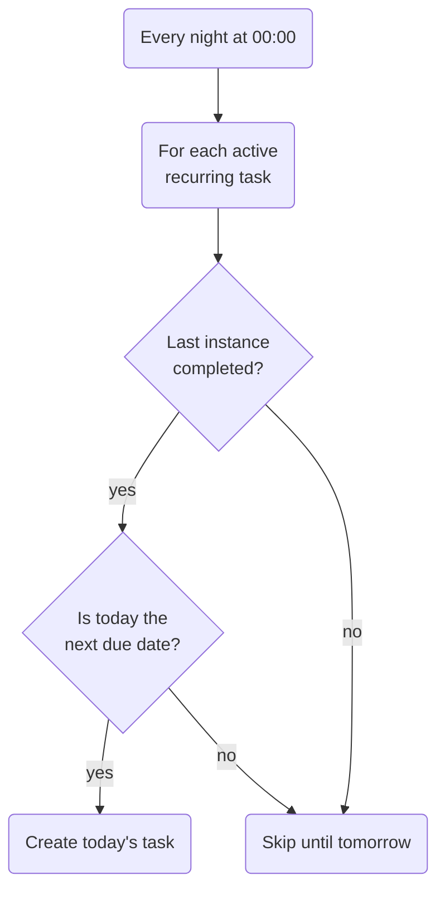

With a data model on paper ([part 1](/blog/redcheck-before-first-commit/)),
the obvious way to start was feature by feature: login, end to end, from
the database to the screen; then subjects, end to end; then tasks. Each
step would give me something I could click.

I didn't do that. I built the whole API first, and only then the
interface.

## Why the backend came first

Working one feature at a time across the whole stack means switching
languages and mental models several times a day: Java, Spring and JPA
in the morning, React and TypeScript in the afternoon, and back. In a
team, different people own different layers. Alone, I was paying the
cost of every switch myself.

So I split the work by layer instead: the database, security and
business logic first, as a REST API I could test on its own; then the
interface on top of a contract that already existed and was documented.
The trade-off was clear: for almost three weeks there was nothing to
look at, only endpoints. In exchange, when I started on the frontend,
every call it needed was already there and already behaved.

The dates in the commit history show what that focus bought. The base,
authentication, subjects and tasks went in over three days, 2 to 4
March. Recurring tasks and daily progress, which I'd expected to take a
week, went in on a single day, 20 March.

## Authentication without sessions

RedCheck uses Spring Security with JSON Web Tokens. Logging in returns a
signed token; the client sends it in the `Authorization` header with
every request, and a filter validates the signature and expiry before
the request reaches any controller. Passwords are hashed with BCrypt.

The server keeps no sessions at all. That makes every request
self-contained and the backend easy to scale or restart, but it has a
consequence people tend to discover late: there is nothing on the server
to "log out" of. Logging out means the client throws its token away. A
stolen token stays valid until it expires, 24 hours later. For a planner,
I took that trade-off. For a bank, I wouldn't.

One of the first commits after setting this up is called *fix: forgotten
/ in requestMatchers*. A missing leading slash in the list of public
routes had put the Swagger documentation behind authentication. Security
configuration fails closed, which is the right default, but it doesn't
tell you why.

## Ownership on every request

Every subject, task and recurring task belongs to a user, and every
query is scoped by the authenticated user's id. Asking for someone
else's task doesn't return it, and trying to modify it throws a specific
exception (`TaskNotOwnedException`, `SubjectNotOwnedException`) instead
of quietly succeeding.

Controllers also never receive or return entities, only DTOs. If the API
accepted entities directly, a client could send fields it should never
control, like an id or a creation date, and the framework would happily
write them to the database. DTOs make the contract explicit and let the
database change without breaking it.

## One endpoint, many questions

The interface would need tasks in many combinations: pending tasks of a
subject, completed ones, overdue ones. The first approach I considered
was a method and a route for each: "pending tasks of a subject", "overdue
tasks", and so on. It would have worked, and it would have multiplied
with every new filter.

Instead, there's one endpoint, `GET /subjects/{id}/tasks`, with optional
`completed` and `overdue` parameters that the service turns into a single
query. One more decision there: whether a task is overdue is computed on
the server, at the moment of the request, and sent as a field. If every
client worked it out from its own clock and time zone, two devices could
disagree about the same task.

## Recurring tasks that don't pile up

This was the most interesting design problem of the backend.

The classic way to implement a recurring task is to generate all of its
future instances when it's created. A daily task for a year is 365 rows.
Stop using the app after a week and 358 of them are dead weight. Worse,
if instances keep appearing whether or not you did the last one, a
missed week leaves you with seven identical pending tasks: a pile that
makes the app feel like a reproach.

RedCheck generates them one at a time. A scheduled job runs every night
at midnight and, for each active recurring task, creates the next
instance only if two conditions hold: the last instance has been
completed, and today is the day the frequency says the next one is due.

The database only holds tasks that are actually relevant, and missing a
day never multiplies into a backlog. The trade-off is deliberate: if you
don't complete a recurring task, it doesn't come back until you do. The
first version supported four fixed frequencies: daily, weekly, every two
weeks and monthly. Months later,
the calendar rework ([part 14](/blog/redcheck-calendar/)) replaced that
with custom weekdays and streaks.

## Progress, stored once a day

The calendar's colours come from the `PROGRESS_RECORD` table from part 1.
A second scheduled job runs at 23:59 and takes a snapshot of each user's
day: the tasks completed that day, against everything that was still
pending. The calendar then reads one row per day instead of counting
tasks.

It's a classic trade: cheap reads, in exchange for a number that is
frozen once written. Complete one of yesterday's tasks today and
yesterday's colour doesn't change. For a historical heatmap, where the
past rarely changes, that was acceptable. Much later, for streaks, I made
the opposite choice and computed them on read, because a stored counter
drifts the moment someone un-completes a past task. Same kind of
problem, different answer, depending on how often the data changes.

## What I took from this stage

- Working alone, splitting by layer beat splitting by feature. The cost
  was weeks with nothing to show; the payoff was a frontend that never
  waited on the backend.
- Stateless auth is simple until you need to revoke something. Know that
  before you pick it.
- The best data is often the data you don't create. Generating recurring
  tasks lazily kept both the database and the user's list clean.

The next part is the other half: turning a sketch into an interface, in
ten days.
