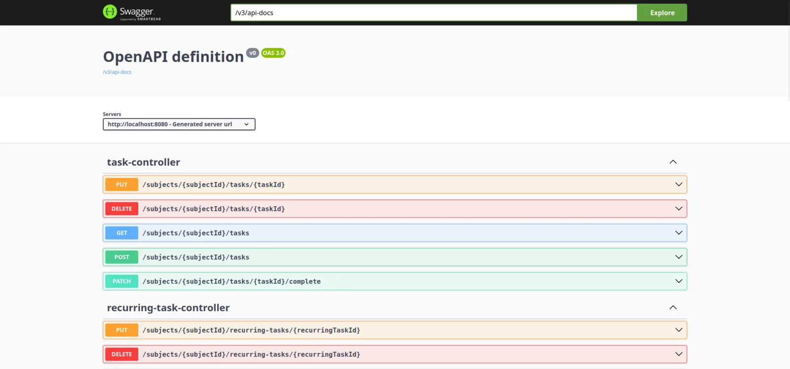
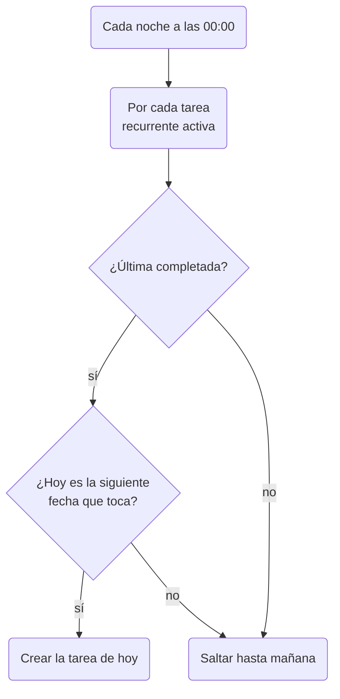

Con un modelo de datos sobre el papel
([parte 1](/es/blog/redcheck-before-first-commit/)), lo obvio era empezar
funcionalidad a funcionalidad: el login, de punta a punta, de la base de
datos a la pantalla; luego las asignaturas, de punta a punta; luego las
tareas. Cada paso me daría algo que poder pulsar.

No lo hice así. Construí primero toda la API, y solo después la
interfaz.

## Por qué primero el backend

Trabajar una funcionalidad cada vez a lo largo de todo el stack significa
cambiar de lenguaje y de forma de pensar varias veces al día: Java,
Spring y JPA por la mañana, React y TypeScript por la tarde, y vuelta a
empezar. En un equipo, cada capa tiene su responsable. Yo solo, pagaba
el coste de cada cambio.

Así que dividí el trabajo por capas: primero la base de datos, la
seguridad y la lógica de negocio, como una API REST que podía probar por
sí sola; después la interfaz, encima de un contrato que ya existía y
estaba documentado. El compromiso estaba claro: durante casi tres semanas
no hubo nada que ver, solo endpoints. A cambio, cuando empecé con el
frontend, cada llamada que necesitaba ya estaba ahí y ya funcionaba.

Las fechas del historial de commits muestran lo que compró ese foco. La
base, la autenticación, las asignaturas y las tareas entraron en tres
días, del 2 al 4 de marzo. Las tareas recurrentes y el progreso diario,
que esperaba que me llevaran una semana, entraron en un solo día, el 20
de marzo.

## Autenticación sin sesiones

RedCheck usa Spring Security con JSON Web Tokens. Al iniciar sesión se
devuelve un token firmado; el cliente lo envía en la cabecera
`Authorization` en cada petición, y un filtro comprueba la firma y la
caducidad antes de que la petición llegue a ningún controlador. Las
contraseñas se guardan con BCrypt.

El servidor no guarda ninguna sesión. Eso hace que cada petición sea
autosuficiente y que el backend sea fácil de escalar o reiniciar, pero
tiene una consecuencia que se suele descubrir tarde: en el servidor no
hay nada de lo que "cerrar sesión". Cerrar sesión significa que el
cliente tira su token. Un token robado sigue siendo válido hasta que
caduca, 24 horas después. Para un planificador, acepté ese compromiso.
Para un banco, no lo haría.

Uno de los primeros commits tras montar esto se llama *fix: forgotten
/ in requestMatchers*. Faltaba la barra inicial en la lista de rutas
públicas, y eso había dejado la documentación de Swagger detrás de la
autenticación. La configuración de seguridad falla cerrando, que es lo
correcto por defecto, pero no te dice por qué.

## Propiedad en cada petición

Cada asignatura, tarea y tarea recurrente pertenece a un usuario, y cada
consulta se filtra por el id del usuario autenticado. Pedir la tarea de
otra persona no la devuelve, e intentar modificarla lanza una excepción
específica (`TaskNotOwnedException`, `SubjectNotOwnedException`) en lugar
de completarse sin más.

Los controladores tampoco reciben ni devuelven nunca entidades, solo
DTOs. Si la API aceptara entidades directamente, un cliente podría enviar
campos que nunca debería controlar, como un id o una fecha de creación, y
el framework los escribiría en la base de datos sin rechistar. Los DTOs
hacen explícito el contrato y permiten cambiar la base de datos sin
romperlo.

## Un endpoint, muchas preguntas

La interfaz iba a necesitar las tareas en muchas combinaciones: las
pendientes de una asignatura, las completadas, las atrasadas. El primer
enfoque que me planteé fue un método y una ruta para cada caso: "tareas
pendientes de una asignatura", "tareas atrasadas", etcétera. Habría
funcionado, y se habría multiplicado con cada filtro nuevo.

En su lugar hay un único endpoint, `GET /subjects/{id}/tasks`, con los
parámetros opcionales `completed` y `overdue`, que el servicio convierte
en una sola consulta. Una decisión más ahí: si una tarea está atrasada se
calcula en el servidor, en el momento de la petición, y se envía como un
campo. Si cada cliente lo calculara con su propio reloj y su zona
horaria, dos dispositivos podrían no estar de acuerdo sobre la misma
tarea.

## Tareas recurrentes que no se acumulan

Este fue el problema de diseño más interesante del backend.

La forma clásica de implementar una tarea recurrente es generar todas sus
repeticiones futuras al crearla. Una tarea diaria durante un año son 365
filas. Deja de usar la app a la semana y 358 sobran. Peor: si las
repeticiones siguen apareciendo hayas hecho o no la anterior, una semana
sin entrar te deja siete tareas pendientes idénticas, una pila que hace
que la app parezca un reproche.

RedCheck las genera de una en una. Un proceso programado se ejecuta cada
noche a medianoche y, por cada tarea recurrente activa, crea la siguiente
solo si se cumplen dos condiciones: la última se ha completado, y hoy es
el día que toca según su frecuencia.

La base de datos solo guarda las tareas que de verdad importan, y saltarse
un día nunca se convierte en una montaña de pendientes. El compromiso es
deliberado: si no completas una tarea recurrente, no vuelve hasta que lo
haces. La primera versión admitía cuatro frecuencias fijas: diaria,
semanal, cada dos semanas y mensual. Meses después, la renovación del
calendario ([parte 14](/es/blog/redcheck-calendar/)) la sustituyó por días
de la semana personalizados y rachas.

## El progreso, guardado una vez al día

Los colores del calendario salen de la tabla `PROGRESS_RECORD` de la
parte 1. Un segundo proceso programado se ejecuta a las 23:59 y toma una
foto del día de cada usuario: las tareas completadas ese día, frente a
todo lo que seguía pendiente. El calendario lee una fila por día en lugar
de contar tareas.

Es un intercambio clásico: lecturas baratas a cambio de un número que se
congela al escribirse. Si hoy completas una tarea de ayer, el color de
ayer no cambia. Para un mapa de calor histórico, donde el pasado cambia
poco, era aceptable. Mucho después, para las rachas, tomé la decisión
contraria y las calculé al leer, porque un contador guardado se desvía en
cuanto alguien desmarca una tarea pasada. El mismo tipo de problema, otra
respuesta, según lo a menudo que cambien los datos.

## Con qué me quedo de esta etapa

- Trabajando solo, dividir por capas funcionó mejor que dividir por
  funcionalidades. El coste fueron semanas sin nada que enseñar; el
  premio, un frontend que nunca esperó al backend.
- La autenticación sin sesiones es sencilla hasta que necesitas revocar
  algo. Conviene saberlo antes de elegirla.
- A menudo, los mejores datos son los que no creas. Generar las tareas
  recurrentes bajo demanda mantuvo limpias tanto la base de datos como la
  lista del usuario.

La siguiente parte es la otra mitad: convertir un boceto en una
interfaz, en diez días.
