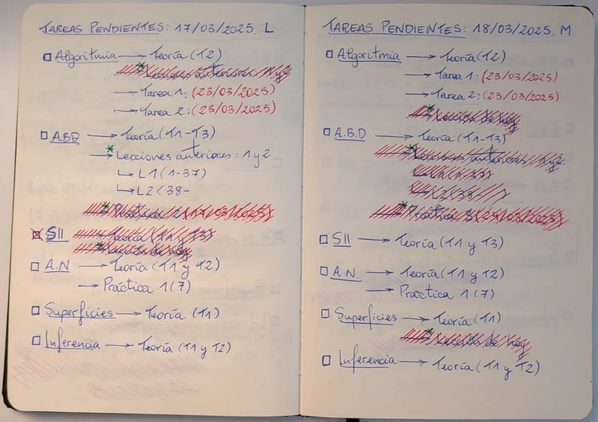
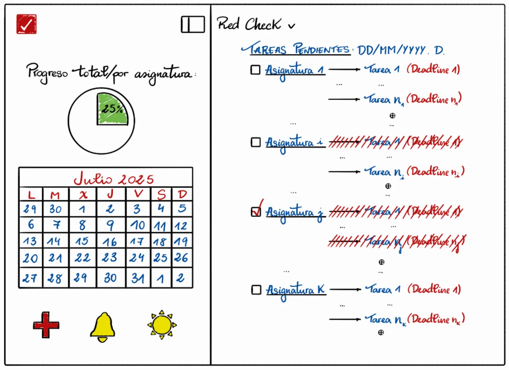
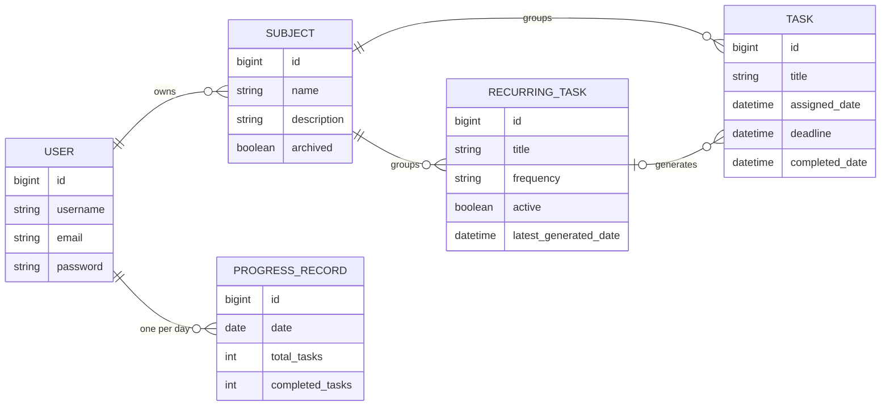

RedCheck went live in June 2026, and this series started there. But the
project is older than its first commit, and a lot of what it is today was
decided before I wrote a single line of code. This part, and the four
after it, go back to the beginning.

## A notebook and a habit

For most of my degree I planned every day the same way, by hand, in a
notebook. At the top of the page went the date and the day of the week:
*Tareas pendientes: 17/03/2025, L*. Below it, one block per subject:
the subject's name, underlined, with a checkbox next to it, and an arrow
to each thing I had to do for it. Deadlines went in red, in brackets.
When I finished something, I crossed it out with red hatching. When every
task of a subject was done, I ticked the subject's box.

It worked. It was fast to write, fast to read, and it showed me at a
glance which subjects were under control and which weren't. It also had
an obvious cost, visible in the photo above: every morning I copied
whatever hadn't been done the day before onto a new page. The plan was
the easy part; the copying was the chore.

## Why not just use an app?

I tried. The problem was never a lack of apps, it was that none of them
matched this way of working:

- **Todoist** is fast and minimal, but its sidebar is full of options I
  didn't need, and the statistics I cared about are behind the paid plan.
- **Notion** can model anything, which is exactly the problem. Building
  my system in it would have meant designing a database before planning
  my day.
- **Google Calendar** thinks in events with a start and an end. Most of
  my tasks were "before Friday", not "Tuesday from 4 to 6".
- **Microsoft To Do** is simple, but it's a list. It doesn't group by
  subject and has no sense of progress over time.

What I wanted was narrower than any of them: open it, see today grouped
by subject, add a task in a few seconds, tick it off. Plus two things a
notebook can't do: carry pending tasks over to the next day by itself,
and show me how consistent I'd been over weeks, not just today.

## From the notebook to a sketch

In July 2025 I drew what that app would look like. The main area is the
notebook page, almost literally: the date at the top, subjects with a
checkbox, arrows to tasks, deadlines in red, finished tasks crossed out.

Everything the notebook couldn't do went into a sidebar that folds out:
progress for the day, overall and per subject, and a month calendar.

Some of those ideas survived almost untouched. The grouping by subject,
the red deadlines and the progress circle are all still in RedCheck
today. Others took a long time: the sun in the corner is a theme switch,
and dark mode only arrived fourteen months later, in
[part 9](/blog/redcheck-two-languages/).

## From the sketch to a data model

Before writing code I wanted the data model right, because that's the
part that is expensive to change later. Two decisions from that stage
shaped everything that came after.

**A subject is an entity, not a label.** My first instinct was the
notebook's: a task has a subject, so give each task a `subject` text
field and group by it on screen. The interface would have looked exactly
the same. The model underneath wouldn't have backed it up: "Maths" and
"maths" would be two subjects, there would be nowhere to store a
subject's description or whether it's archived, and renaming one would
mean updating every task. So `SUBJECT` became its own table, and every
task points to one.

**A recurring task is not a task.** The tempting design was a single
`TASK` table with an `is_recurring` flag and a frequency column. But the
two have different lifecycles. A task is created by the user, has an
optional deadline and ends when it's completed. A recurring task is a
template: it has no deadline, it's never "completed", only switched on
or off, and the actual tasks are generated from it by the system. One
table for both would have meant half the columns being null depending
on the row, and every query having to remember which kind it was
looking at. So they're two tables, linked by an optional foreign key.

A third decision came from thinking about the calendar. I wanted each
day coloured by how much of it I'd completed, like GitHub's contribution
graph. Computing that on the fly means aggregating every task for every
visible day, every time the calendar loads. Instead, a
`PROGRESS_RECORD` row stores each user's completion for each day, and
the calendar just reads it.

## What I took from this stage

- The best product spec I had was a habit I'd repeated for years. The
  sketch was mostly a translation of it.
- Drawing the interface first told me what the data model had to
  support. The model then caught things the drawing hid, like a subject
  needing to exist on its own.
- Every app I tried was good. None was *mine*. That gap is a perfectly
  good reason to build something.

On 2 March 2026 I made the first commit. The next part is about the
backend that came out of it, and about building it before a single
screen existed.
