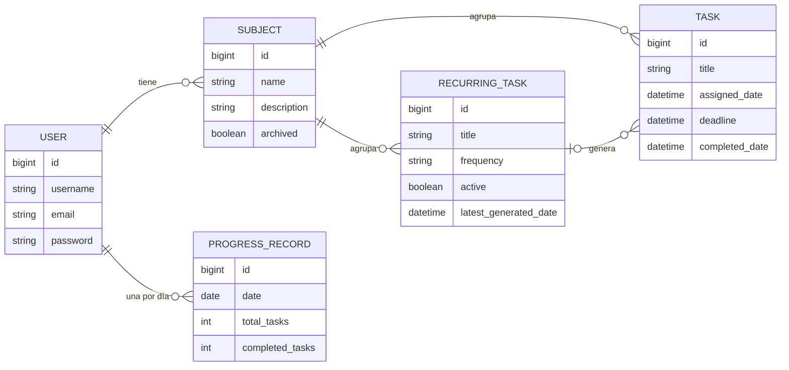

RedCheck salió a producción en junio de 2026, y esta serie empezaba ahí.
Pero el proyecto es más antiguo que su primer commit, y buena parte de lo
que es hoy se decidió antes de escribir una sola línea de código. Esta
parte, y las cuatro siguientes, vuelven al principio.

## Una libreta y una costumbre

Durante casi toda la carrera planifiqué cada día igual, a mano, en una
libreta. Arriba de la página, la fecha y la inicial del día:
*Tareas pendientes: 17/03/2025, L*. Debajo, un bloque por asignatura: el
nombre subrayado, con una casilla al lado, y una flecha hacia cada cosa
que tenía que hacer. Las fechas límite, en rojo y entre paréntesis.
Cuando terminaba algo, lo tachaba con un rayado rojo. Cuando terminaba
todas las tareas de una asignatura, marcaba su casilla.

Funcionaba. Era rápido de escribir, rápido de leer, y me enseñaba de un
vistazo qué asignaturas tenía controladas y cuáles no. También tenía un
coste evidente, que se ve en la foto de arriba: cada mañana copiaba en
una página nueva todo lo que no había terminado el día anterior. Planificar
era lo fácil; copiar era la carga.

## ¿Por qué no usar una app?

Lo intenté. El problema nunca fue que faltaran apps, sino que ninguna
encajaba con esta forma de trabajar:

- **Todoist** es rápida y minimalista, pero su barra lateral está llena
  de opciones que no necesitaba, y las estadísticas que me interesaban
  son de pago.
- **Notion** puede modelar cualquier cosa, y ese es justo el problema.
  Montar mi sistema ahí habría significado diseñar una base de datos
  antes de planificar mi día.
- **Google Calendar** piensa en eventos con inicio y fin. La mayoría de
  mis tareas eran "antes del viernes", no "el martes de 4 a 6".
- **Microsoft To Do** es sencilla, pero es una lista. No agrupa por
  asignatura ni tiene ninguna idea de progreso en el tiempo.

Lo que yo quería era más concreto que cualquiera de ellas: abrirla, ver
el día agrupado por asignaturas, añadir una tarea en unos segundos,
marcarla. Y dos cosas que una libreta no puede hacer: pasar sola las
tareas pendientes al día siguiente, y enseñarme lo constante que había
sido durante semanas, no solo hoy.

## De la libreta al boceto

En julio de 2025 dibujé cómo sería esa app. La zona principal es la
página de la libreta, casi literalmente: la fecha arriba, asignaturas con
casilla, flechas hacia las tareas, fechas límite en rojo, tareas
terminadas tachadas.

Todo lo que la libreta no podía hacer fue a una barra lateral que se
despliega: el progreso del día, total y por asignatura, y un calendario
mensual.

Algunas de esas ideas sobrevivieron casi intactas. La agrupación por
asignaturas, las fechas límite en rojo y el círculo de progreso siguen en
RedCheck hoy. Otras tardaron bastante: el sol de la esquina es un
selector de tema, y el modo oscuro no llegó hasta catorce meses después,
en la [parte 9](/es/blog/redcheck-two-languages/).

## Del boceto al modelo de datos

Antes de escribir código quería tener bien el modelo de datos, porque es
lo que sale caro cambiar después. Dos decisiones de esa etapa marcaron
todo lo que vino luego.

**Una asignatura es una entidad, no una etiqueta.** Mi primer instinto
fue el de la libreta: una tarea tiene una asignatura, así que basta con
un campo de texto `asignatura` en cada tarea y agrupar por él en
pantalla. La interfaz habría sido idéntica. El modelo de debajo no la
habría respaldado: "Mates" y "Matemáticas" serían dos asignaturas
distintas, no habría dónde guardar la descripción de una asignatura o si
está archivada, y renombrarla obligaría a tocar todas sus tareas. Así que
`SUBJECT` pasó a ser su propia tabla, y cada tarea apunta a una.

**Una tarea recurrente no es una tarea.** El diseño tentador era una
única tabla `TASK` con un indicador `is_recurring` y una columna de
frecuencia. Pero las dos tienen ciclos de vida distintos. Una tarea la
crea el usuario, tiene una fecha límite opcional y termina cuando se
completa. Una tarea recurrente es una plantilla: no tiene fecha límite,
nunca se "completa", solo se activa o desactiva, y las tareas reales las
genera el sistema a partir de ella. Una sola tabla para ambas habría
dejado la mitad de las columnas vacías según la fila, y cada consulta
tendría que recordar qué tipo estaba mirando. Así que son dos tablas,
unidas por una clave foránea opcional.

Una tercera decisión salió de pensar en el calendario. Quería cada día
coloreado según cuánto había completado, como el gráfico de
contribuciones de GitHub. Calcularlo al vuelo significa agregar todas las
tareas de cada día visible, cada vez que se carga el calendario. En su
lugar, una fila de `PROGRESS_RECORD` guarda lo que cada usuario completó
cada día, y el calendario solo tiene que leerla.

## Con qué me quedo de esta etapa

- La mejor especificación de producto que tenía era una costumbre que
  llevaba años repitiendo. El boceto fue sobre todo una traducción de
  ella.
- Dibujar primero la interfaz me dijo qué tenía que soportar el modelo
  de datos. Y el modelo detectó cosas que el dibujo escondía, como que
  una asignatura tenía que existir por sí misma.
- Todas las apps que probé eran buenas. Ninguna era *la mía*. Ese hueco
  es un motivo perfectamente válido para construir algo.

El 2 de marzo de 2026 hice el primer commit. La siguiente parte trata del
backend que salió de ahí, y de construirlo antes de que existiera una
sola pantalla.
