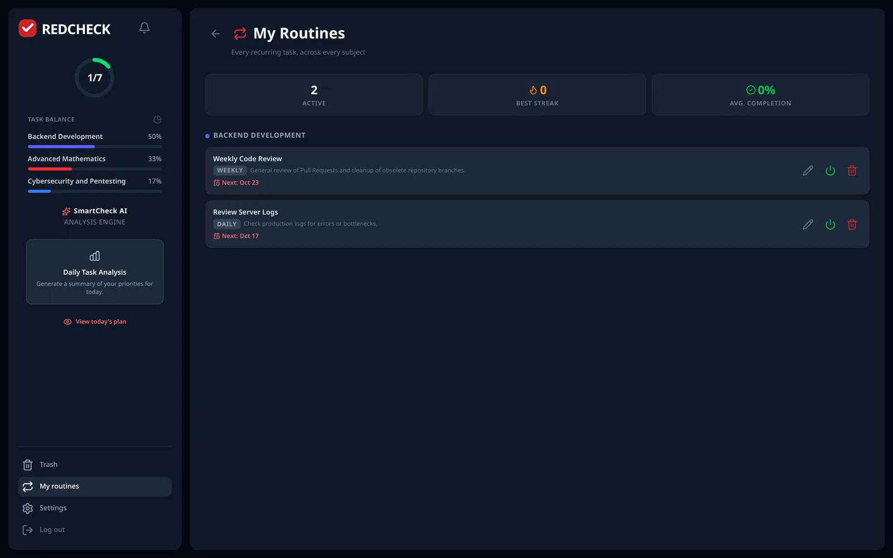
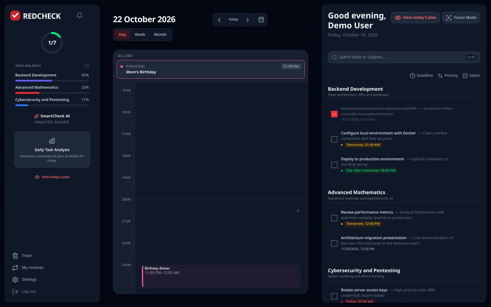

RedCheck had a calendar with Day, Week and Month views. If I'm honest,
two of the three were decorations. Week view drew an empty dashed box for
each day. Day view drew an hourly grid with a "now" line, and then listed
your tasks on top of it, ignoring the hours completely.

This post is about turning that calendar, and the routines behind it,
into something you'd actually plan your week with. It's also the first
time in this series where most of the work started in the backend.

## Making the views real

Week view now shows the actual tasks for each day, coloured by subject.
Day view places each task in its real hour across the full 24 hours, with
an "all day" strip for deadlines without a time, and scrolls to the
current hour when it opens.

On desktop you can drag any task onto another day or hour to reschedule
it. I used native HTML5 drag and drop, which is mouse-only by design. On
touch devices a tap still opens the task editor, so the behaviour is
never ambiguous.

Building the Day view exposed a lot of layout bugs that had been hidden
because nothing was actually aligned to the grid before: an hour column
and a task column scrolling independently and only lining up by accident,
flex rows shrinking below their height, and a background that stopped
painting at noon because of how flexbox stretches items. None of them
were interesting individually. Together they were a good reminder that
"it looks right" and "it's built right" are different things.

## Past days were empty, and the dashboard was slow

Two backend problems surfaced quickly.

**The dashboard made one request per subject.** It fetched the list of
subjects, then the tasks of each one. With ten subjects, that's eleven
HTTP requests to render one screen, the classic N+1 problem, just across
the network instead of inside the database. A new endpoint returns
subjects with their tasks in one response, using exactly two queries
(subjects, then all of the user's relevant tasks) grouped in memory.

**The calendar couldn't show history.** The dashboard only loads pending
tasks and those completed today, so a past day in the calendar showed
nothing but a heatmap count. A new top-level endpoint returns every task,
pending or completed, whose deadline falls within a date range. I made it
top-level rather than nested under a subject for the same N+1 reason. The
calendar fetches one range per view, and only when that range contains a
past day.

## Priorities, and a migration strategy I had to own up to

Tasks now have a priority: low, medium or high. Two decisions are worth
explaining.

**Medium is invisible.** Every task defaults to medium, and medium shows
no badge at all. Only low and high do. If every task carries a label,
nobody reads labels.

**Priority has its own colour palette**, separate from subject colours,
because they're two different dimensions and the calendar already uses
colour for subjects.

The less glamorous part: RedCheck has no migration tool like Flyway or
Liquibase. Schema changes are applied by Hibernate's `ddl-auto=update`.
Adding a non-null column to a table with existing rows only works if the
database itself has a default, so the column declares one at the database
level, not just in Java. It works, and I've now documented it, but I
know it's a shortcut. The first schema change that `update` can't express
safely (a rename, a split column) is the day I introduce a proper
migration tool.

## Routines that behave like routines

Recurring tasks used to support four presets: daily, weekly, every two
weeks and monthly. Real routines don't look like that.

**Specific weekdays.** "Monday and Thursday" is stored as a restricted
cron expression and evaluated with Spring's own `CronExpression`, with no
new dependency. The validation only accepts that exact shape, so every
stored value can always be turned back into checkboxes in the edit form.
Accepting arbitrary cron would have been more flexible and impossible to
edit through a UI.

**A specific day of the month, or the last day.** This one is handled by
hand, not with cron. Spring's cron implementation has no "last day of
month" operator, and a plain "day 31" rule silently skips every month
that doesn't have one. For a routine like "pay rent on the 31st", the
user means "the last day", not "seven times a year".

**A time of day and an end date.** Generated tasks now get a real
deadline time, and a routine with an end date generates its final
occurrence on that day and then deactivates itself.

**A live preview** in the form shows the next few dates a routine will
fire, computed client-side so it updates as you type. It deliberately
replicates one quirk of the backend scheduler (a new routine's first
occurrence is always on the next scheduler run) so the preview never
promises something the server won't do.

**Streaks and completion rate** per routine. These are computed from the
routine's full history on every read, not stored as counters. A stored
counter drifts the moment someone deletes or un-completes a past
occurrence. A routine's history is small enough that recomputing it is
cheap, and it can never be wrong.

One robustness fix came with this: the scheduler used to process all
routines in one loop, so a single unparseable frequency would abort
generation for every user. Each routine is now processed in isolation.

## A deploy that returned the wrong thing, successfully

The new "all my routines" view worked locally and broke in production. The cause: nginx only proxied a known list of
API paths to the backend. The new `/recurring-tasks` path wasn't on it,
so it fell through to the single-page app's catch-all and returned
`index.html` with a `200 OK`. No error anywhere; the response was just
HTML instead of JSON. `curl` and the `Content-Type` header found it in a
minute, once I thought to look.

## Events are not tasks

The latest addition is calendar events: meetings, birthdays, trips. It
was tempting to model them as tasks with a flag. I didn't, because they
are genuinely different things. A task has a deadline and gets
completed. An event has a start and an end and simply happens. Mixing
them would have polluted every statistic and every "pending" count in the
app.

So events are their own domain: user-defined, colour-coded categories,
one-off and recurring events (with a new yearly frequency for
birthdays), all-day and timed. In Day view, timed events are blocks that
span their duration, and you can press and drag on the timeline to
create one. In Month view, multi-day events render as continuous banners
across the days they cover.

Those banners caused my favourite bug of the month. Banners and day cells
share one CSS grid. Banners had explicit grid positions; day cells relied
on auto-placement. Per the CSS Grid specification, auto-placed items skip
cells already claimed by explicitly placed ones, so any day with a banner
silently pushed every following day in that row into the wrong weekday.
Day cells now get explicit coordinates too. While I was there, all
day-matching logic was rewritten to compare whole-day integers instead of
timestamps, which removed a whole class of boundary bugs.

The demo accounts were updated with sample events, with dates relative
to the current day so they stay current through the hourly reset. That
exposed one more issue: two overlapping runs of the reset procedure could
each insert their own copy of the data. It's now wrapped in a
non-blocking named lock; a second concurrent run simply does nothing.

## What's next

Google Calendar sync is designed (a read-only overlay of your events,
plus opt-in export of RedCheck tasks to a dedicated calendar) and waiting
on Google's OAuth verification. I told the story of that verification
process in part 8.

## What I took away

- N+1 problems also happen over HTTP. Count your requests, not just your
  queries.
- Restrict flexible formats to what your UI can edit back.
- Compute derived statistics on read until you have a reason not to.
- Model what things *are*, not what's convenient: events aren't tasks.
- If you're not using a migration tool, write down why, and when you
  will.

Plan your week with the demo account at
[redcheckapp.com](https://redcheckapp.com/).
