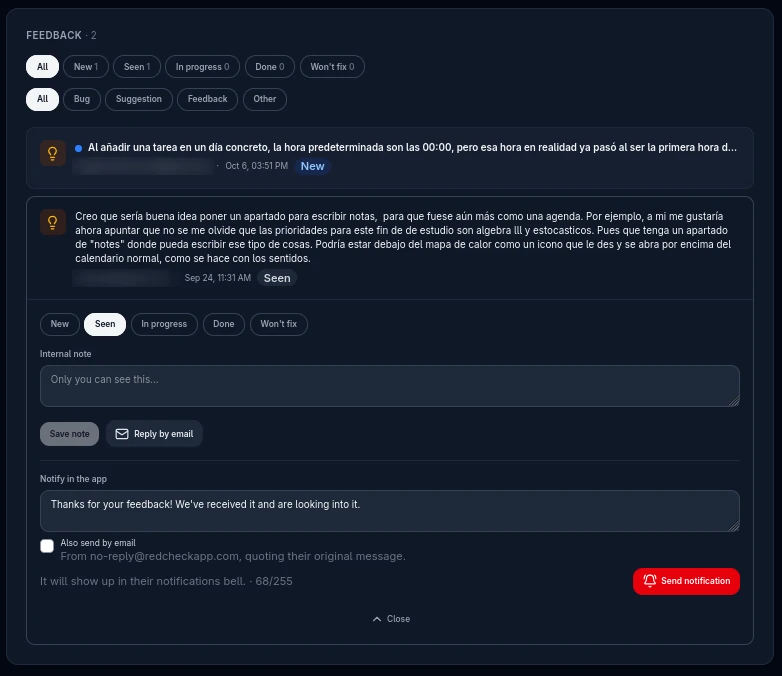
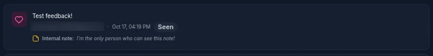
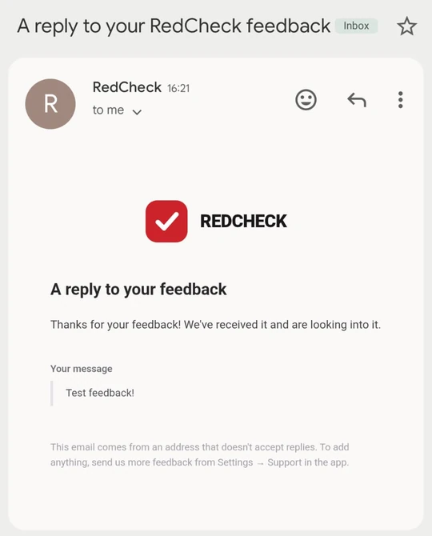
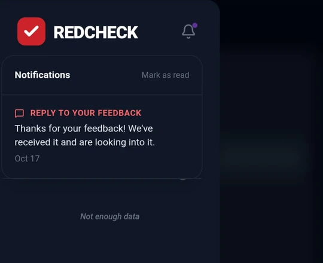
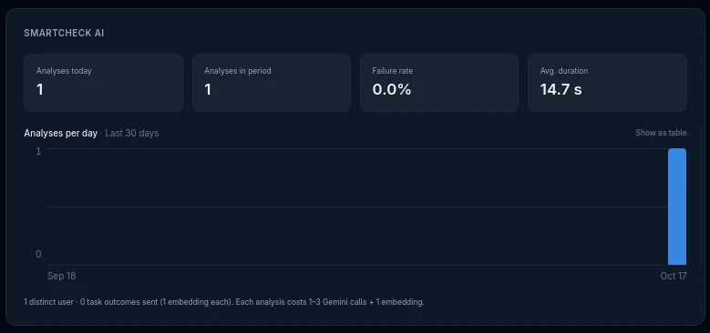
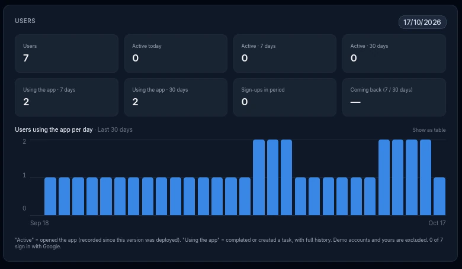
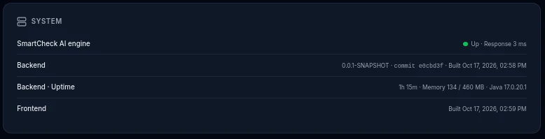

Since September, RedCheck has had a small form in Settings to report a
bug or suggest something. It worked. The only way to read what people
sent was to open a MySQL console on the production server and run a
`SELECT`.

That's fine once. It's not fine as the way you listen to your users.
So I started sketching a dashboard inside RedCheck, visible only to me.
Then I stopped and asked whether it was worth building at all.

## What not to build

A "developer dashboard" invites scope creep. Latency charts, error
rates, CPU, memory, a list of every user. I cut most of it before
writing any code.

- **No performance monitoring.** Tools like Sentry, Grafana or Uptime
  Kuma do it better, and they keep working when the app is down. A
  dashboard that lives inside the backend can't tell you the backend
  has crashed.
- **No browsing individual users' data.** Even if only I can see it,
  the page shows aggregates. The one exception is feedback, where I need
  the author's email to answer them.
- **What stays is what only my database knows:** the feedback, how
  often the AI is used (which is what costs money), and whether people
  come back.

I split it into three phases: the feedback inbox and AI usage first,
then active users, then a small system section. All of it lived on a
feature branch, got tested locally, and only then became a pull request.

## Only me, enforced by the backend

There's exactly one admin, so a roles table would have been ceremony.
Access is an allowlist in an environment variable, `ADMIN_EMAILS`, and
Spring Security restricts everything under `/admin/**` to it. The
profile endpoint also returns an `isAdmin` flag so the frontend knows
whether to show the entry point in Settings. That flag is cosmetic:
anyone who types `/developer` by hand gets a `403` from the API and a
"No access" screen.

The test for that rule caught something before it shipped. A regular
user got `200` instead of `403`. The rule was fine; the test wasn't.
RedCheck's `User` entity uses Lombok's
`@EqualsAndHashCode(onlyExplicitlyIncluded = true)` with no fields
included, so **every user is equal to every other user**. A mock set up
to answer "yes" for the admin answered "yes" for everybody. The stub now
matches by email, and that quirk is documented where the next person
will look.

## A feedback inbox

Most of the feedback table's problem was that it had no state. You
couldn't tell what you had already read. Each entry now has a status
(new, seen, in progress, done, won't fix) and a private note. Opening a
new entry marks it as seen automatically, so the "new" count means
something without a separate "mark as read" step.

Once a note is saved and the entry is closed, it stays visible under the
author's line, so I don't have to reopen anything to remember why.

I also get an email for every new submission. That reused the Resend
setup from the password-reset work ([part 13](/blog/redcheck-password-reset/)),
and the user's message is HTML-escaped before it goes into the email,
because it's user input.

![A Gmail message titled "[RedCheck] PRAISE: Test feedback!" with the category, "Nuevo feedback en RedCheck", the sender's email, the message in a grey box and an "Abrir panel de desarrollador" button.](./email-new-feedback.webp "The heads-up I get for every new submission. It's in Spanish, since I'm its only reader.")

Answering was the interesting decision. There were three options:

- **A `mailto:` link.** No backend at all, and the conversation
  continues in my inbox. But nothing is recorded in the app.
- **A notification inside RedCheck.** Cheap, and the person sees that
  their suggestion led somewhere. But only if they open the app again.
- **An email from the app's no-reply address.** It reaches people who
  never come back. But it's one-way: a reply goes nowhere.

I shipped all three, layered: the `mailto:` link for conversations, the
in-app notification as the default reply, and a checkbox to also send it
by email. The email quotes their original message and says plainly that
the address doesn't accept replies.

The in-app part held a surprise. RedCheck's backend had been creating
notifications for months, and the frontend had never shown a single one.
The bell only displayed a local "your AI plan is ready" flag. Listing
everything would have dumped months of unread, English-only AI
notifications on every user at once. So notifications now have a type,
and the bell shows only replies to your feedback.

## What the AI costs

The obvious way to count AI usage was the table where analyses are
stored. It would have been wrong twice. Running a new analysis deletes
the previous one from the same day, and failed calls are never stored.
So every call to the AI engine now writes one row to its own log:
the type of call, whether it succeeded, and how long it took. That write runs in its own
transaction and catches its own errors. Losing a log row is fine.
Breaking someone's analysis because a log write failed is not.

The honest limit: this counts calls, not tokens. The engine retries
Gemini up to three times internally and doesn't return token usage yet,
so one analysis costs between one and three model calls plus an
embedding. Real token counts need a change in the engine itself, and the
dashboard says so instead of showing a number that looks precise and
isn't.

## Two definitions of an active user

"How many active users do I have?" sounds like one number. I ended up
showing two, because each one is honest about something different.

- **Active**: had an authenticated request in the period. RedCheck now
  stores a `lastSeenAt` per user. To avoid a database write on every
  request, it's refreshed at most once an hour, and the check is in
  memory against the user the JWT filter has already loaded. It's exact,
  but it only starts counting from the day it was deployed.
- **Using the app**: completed a task or created one by hand in the
  period. It's computed from data RedCheck already had, so it has full
  history from day one. Tasks generated by recurring routines don't count
  as "created", since the user didn't create them, but completing one
  does.

Both leave out the public demo accounts, which anyone trying RedCheck
shares, and my own account. Either would inflate every number.

The difference between the two is useful in itself. Someone who opens
the app every day and never completes anything is telling me something
too.

## Which build is running?

The last section is the smallest, and the one I'll probably open most.
It shows the commit and build time of the running backend, the
frontend's build time, uptime, memory, and whether the AI engine answers
its health check.

When something that should work doesn't, the first question is always
the same: is the code I'm looking at the code that's running? In
[part 13](/blog/redcheck-password-reset/), new email settings never
reached production because one repository had no deploy pipeline, and it
took a session on the server to find out. Now the answer is on a page.
CI passes the commit into the Docker image when it builds it, and the
backend reports it. A local build says "local build" instead of
pretending to know.

## What I took away

- Before building a dashboard, decide what it's not for. Monitoring that
  dies with your app isn't monitoring.
- Count from an event log, not from tables that keep only the latest
  state.
- "Active user" is a definition, not a fact. Show which one you mean.
- "Which commit is running?" should take one glance, not an SSH
  session.
- The reply you can send in one click is the one you'll actually send.

If you've sent feedback from RedCheck's Settings, it's no longer sitting
in a table. I'm reading it.
