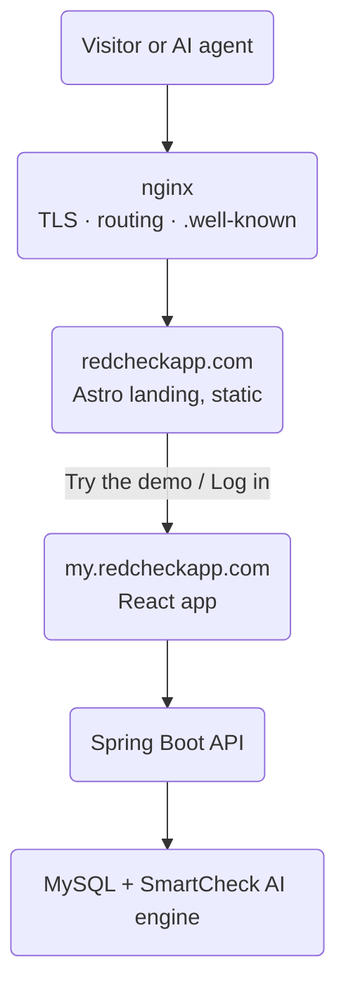

For its first months, RedCheck's front door was a login form. If you
followed a link to it, the first thing you were asked to do was hand over
an email address, with no idea what you were signing up for.

That's backwards. So at the end of August I built a proper landing page,
and in the process RedCheck went from "one app on a domain" to a small
system with a clear shape:

- `redcheckapp.com`: a static landing page, built with Astro.
- `my.redcheckapp.com`: the React app itself.
- `redcheck-infrastructure`: a new repository that owns the
  `docker-compose.yml`, the nginx configuration and the database seed
  scripts.

## Why a separate site and not another route in the app

I could have added a `/` route to the existing React app and called it
the landing page. I chose not to, for three reasons:

1. **Speed and SEO.** A single-page app ships a JavaScript bundle before
   it can show anything meaningful. A marketing page should be plain HTML
   that a crawler, a slow phone or a link preview can read instantly.
   Astro gives me that by default and only hydrates the few interactive
   pieces.
2. **Different release cadence.** Copy changes, screenshots and GIFs on
   the landing page have nothing to do with the app's code. Separating
   them means fixing a typo doesn't rebuild and redeploy the product.
3. **Clear boundaries.** The landing page is public and crawlable. The
   app is authenticated. Putting them on different hosts makes that
   boundary explicit, for people and for bots.

The cost is that two sites now have to *feel* like one. Theme and
language are the obvious examples: a visitor who chooses English and dark
mode on the landing page should arrive at the login screen in English and
dark mode. That's why those preferences live in a cookie scoped to the
parent domain instead of `localStorage`, which is per-origin.

## What's on the page

The page tells a short story: the problem (too many tasks, no idea where
to start), how RedCheck approaches it, a quick interactive demo of the AI
sorting a list by risk, and a short personal section about why I'm
building it.

The feature section uses GIFs and screenshots of the real app. Since the
app has two themes and two languages, every asset exists in four
versions (light and dark, English and Spanish), and the page shows the one
that matches the visitor's current settings. That's more assets to
maintain, but showing a Spanish light-mode screenshot to an English user
in dark mode looks careless.

## Performance and mobile

The first version was heavy: about 4.1 MB of images. Converting them to
WebP with a PNG/GIF fallback through `<picture>`, adding explicit
dimensions to avoid layout shift, and lazy-loading everything below the
fold took that down to roughly 724 KB.

Mobile needed its own pass. A few things I ran into:

- The fixed navbar covered the hero heading on small screens.
- `overflow-x: hidden` on `<body>` alone wasn't enough on some mobile
  browsers; the page could still drift sideways and drag the fixed navbar
  with it. It had to go on `<html>` too.
- A three-column "how it works" grid doesn't work at 360 px, so on phones
  it became a tap-to-advance carousel, one step at a time. Desktop keeps
  the grid.
- The animated particle background was reduced on mobile: fewer particles
  and links, for smoother scrolling and less battery drain.

Add canonical URLs, Open Graph and Twitter Card metadata, a generated
social preview image, and JSON-LD describing the application, the
organisation and the person behind it, and the page is in good shape for
search engines and link previews.

## Making the site readable by AI agents

This is the part I found most interesting. More and more people ask an
assistant about a product instead of searching for it, and those
assistants increasingly read websites directly. So I treated AI agents as
a second audience:

- **`llms.txt`**, following the llmstxt.org format: a plain-text summary
  of what RedCheck is, how it's built, and where to find things, written
  to be dropped straight into a model's context.
- **`robots.txt`** explicitly lists the current AI crawlers (OpenAI,
  Anthropic, Google, Perplexity, Apple and others), and uses a content
  signal that allows the page to be used as **input** for answering
  questions, while **disallowing** its use for model training. I'm happy
  for an assistant to read RedCheck's page to answer a user's question. I
  don't need it baked into the next foundation model.
- **Machine-readable discovery documents** under `/.well-known/`: an API
  catalogue (RFC 9727) and OAuth authorization-server and
  protected-resource metadata (RFC 8414 and RFC 9728), plus an
  `auth.md` describing how authentication works. nginx advertises the
  catalogue with a `Link` header on every response.

One small infrastructure detail made this harder than expected: those
`.well-known` files have no extension, so nginx served them with a
generic content type. Agents and validators expect
`application/linkset+json` or `application/json`, so nginx now overrides
the content type for those exact paths.

Is this premature for a project of this size? Possibly. But it's cheap,
it's static, and it's the kind of thing that is much easier to design in
from the start than to retrofit.

## Infrastructure gets its own repository

With a landing page, a frontend, a backend, a database and (as the previous
post explains) a separate AI service, the `docker-compose.yml` and the
nginx config no longer belonged inside any one application's repository.
They describe how the pieces fit together, so they now live in
`redcheck-infrastructure`.

Each application still builds and deploys its own Docker image through
its own pipeline. The infrastructure repository is the one place that
says which images run, how they talk to each other, and how traffic
reaches them. That split has a sharp edge, which I found out the hard way
a couple of weeks later. I'll cover it in the next post.

## What I took away

- A product needs a front door that explains it before asking for
  anything.
- Static sites are still the right tool for pages whose job is to be
  read.
- Splitting into subdomains is easy. Making them feel like one site is
  the actual work.
- AI agents are a real audience now. A few static files go a long way,
  and you get to choose what they can and can't do with your content.

Have a look at [redcheckapp.com](https://redcheckapp.com/), on your
phone if you can.
