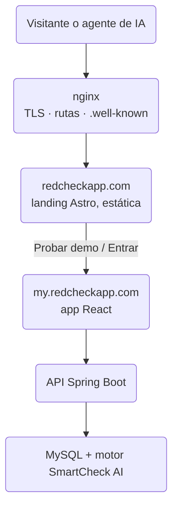
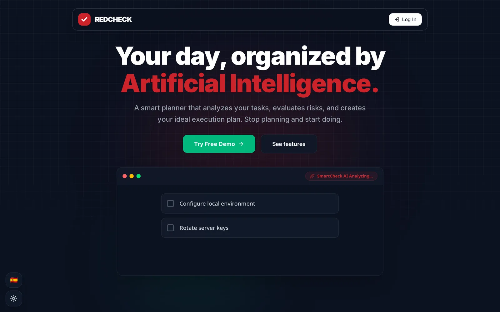
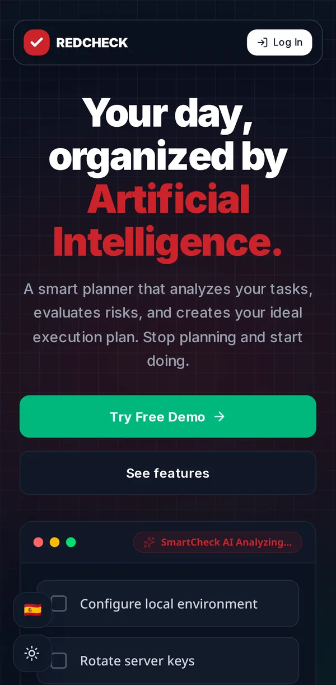

Durante sus primeros meses, la puerta de entrada de RedCheck era un
formulario de login. Si llegabas por un enlace, lo primero que se te
pedía era un correo electrónico, sin tener ni idea de a qué te estabas
apuntando.

Eso es empezar la casa por el tejado. Así que a finales de agosto
construí una landing en condiciones, y por el camino RedCheck pasó de ser
"una app en un dominio" a un pequeño sistema con una forma clara:

- `redcheckapp.com`: una landing estática, hecha con Astro.
- `my.redcheckapp.com`: la app de React.
- `redcheck-infrastructure`: un repositorio nuevo que se encarga del
  `docker-compose.yml`, la configuración de nginx y los scripts de datos
  iniciales de la base de datos.

## Por qué un sitio aparte y no otra ruta en la app

Podría haber añadido una ruta `/` a la app de React y llamarla landing.
Decidí no hacerlo por tres motivos:

1. **Velocidad y SEO.** Una single-page app tiene que enviar un bundle de
   JavaScript antes de poder enseñar nada útil. Una página de marketing
   debería ser HTML plano que un crawler, un móvil lento o la vista previa
   de un enlace puedan leer al instante. Astro me da eso por defecto y
   solo hidrata las pocas piezas interactivas.
2. **Ritmos de publicación distintos.** Los textos, capturas y GIFs de la
   landing no tienen nada que ver con el código de la app. Separarlos
   significa que corregir una errata no recompila ni redespliega el
   producto.
3. **Fronteras claras.** La landing es pública y rastreable. La app
   requiere autenticación. Ponerlas en hosts distintos hace explícita esa
   frontera, para las personas y para los bots.

El coste es que ahora dos sitios tienen que *sentirse* como uno. El tema
y el idioma son el ejemplo obvio: quien elige inglés y modo oscuro en la
landing debería llegar a la pantalla de login en inglés y en modo oscuro.
Por eso esas preferencias viven en una cookie asociada al dominio padre en
vez de en `localStorage`, que va por origen.

## Qué hay en la página

La página cuenta una historia corta: el problema (demasiadas tareas y
ninguna idea de por dónde empezar), cómo lo aborda RedCheck, una demo
interactiva rápida de la IA ordenando una lista por riesgo y una pequeña
sección personal sobre por qué lo estoy construyendo.

La sección de funcionalidades usa GIFs y capturas de la app real. Como la
app tiene dos temas y dos idiomas, cada recurso existe en cuatro
versiones (claro y oscuro, inglés y español), y la página muestra la que
corresponde a la configuración del visitante. Son más recursos que
mantener, pero enseñarle una captura en español y en modo claro a alguien
que navega en inglés y en modo oscuro da sensación de descuido.

## Rendimiento y móvil

La primera versión pesaba mucho: unos 4,1 MB de imágenes. Convertirlas a
WebP con PNG o GIF de respaldo mediante `<picture>`, añadir dimensiones
explícitas para evitar saltos de maquetación y cargar en diferido todo lo
que queda por debajo del primer pantallazo lo dejó en unos 724 KB.

El móvil necesitó su propia pasada. Algunas cosas con las que me
encontré:

- La barra de navegación fija tapaba el titular principal en pantallas
  pequeñas.
- `overflow-x: hidden` solo en `<body>` no bastaba en algunos navegadores
  móviles; la página aún podía desplazarse de lado y arrastrar consigo la
  barra fija. Hubo que ponerlo también en `<html>`.
- Una cuadrícula de tres columnas para "cómo funciona" no cabe en 360 px,
  así que en móvil se convirtió en un carrusel que avanza con cada toque,
  un paso cada vez. En escritorio se mantiene la cuadrícula.
- El fondo animado de partículas se redujo en móvil: menos partículas y
  menos conexiones, para un scroll más fluido y menos gasto de batería.

Si a eso le sumas URLs canónicas, metadatos de Open Graph y Twitter Card,
una imagen de vista previa generada y JSON-LD que describe la aplicación,
la organización y la persona que hay detrás, la página queda en buena
forma para buscadores y vistas previas de enlaces.

## Que la web la puedan leer agentes de IA

Esta es la parte que más me interesó. Cada vez más gente le pregunta a un
asistente por un producto en lugar de buscarlo, y esos asistentes leen
las webs directamente cada vez más. Así que traté a los agentes de IA
como un segundo público:

- **`llms.txt`**, siguiendo el formato de llmstxt.org: un resumen en
  texto plano de qué es RedCheck, cómo está construido y dónde encontrar
  cada cosa, escrito para meterlo tal cual en el contexto de un modelo.
- **`robots.txt`** enumera explícitamente los crawlers de IA actuales
  (OpenAI, Anthropic, Google, Perplexity, Apple y otros) y usa una señal
  de contenido que permite usar la página como **entrada** para responder
  preguntas, pero **prohíbe** usarla para entrenar modelos. Me parece
  bien que un asistente lea la página de RedCheck para responder a la
  pregunta de un usuario. No necesito que acabe dentro del próximo modelo
  fundacional.
- **Documentos de descubrimiento legibles por máquinas** en
  `/.well-known/`: un catálogo de API (RFC 9727) y los metadatos OAuth
  del servidor de autorización y del recurso protegido (RFC 8414 y RFC
  9728), además de un `auth.md` que explica cómo funciona la
  autenticación. nginx anuncia el catálogo con una cabecera `Link` en
  cada respuesta.

Un pequeño detalle de infraestructura lo complicó más de lo esperado:
esos ficheros de `.well-known` no tienen extensión, así que nginx los
servía con un tipo de contenido genérico. Los agentes y validadores
esperan `application/linkset+json` o `application/json`, así que ahora
nginx sobrescribe el tipo de contenido para esas rutas exactas.

¿Es prematuro para un proyecto de este tamaño? Puede. Pero es barato, es
estático, y es de esas cosas que cuesta mucho menos diseñar desde el
principio que añadir después.

## La infraestructura tiene su propio repositorio

Con una landing, un frontend, un backend, una base de datos y (como
explica el post anterior) un servicio de IA aparte, el
`docker-compose.yml` y la configuración de nginx ya no pertenecían a
ningún repositorio de aplicación concreto. Describen cómo encajan las
piezas, así que ahora viven en `redcheck-infrastructure`.

Cada aplicación sigue construyendo y desplegando su propia imagen de
Docker con su propio pipeline. El repositorio de infraestructura es el
único sitio que dice qué imágenes se ejecutan, cómo se comunican entre
ellas y cómo les llega el tráfico. Esa separación tiene una arista
afilada que descubrí por las malas un par de semanas después. Lo cuento
en el siguiente post.

## Con qué me quedo

- Un producto necesita una puerta de entrada que lo explique antes de
  pedir nada.
- Los sitios estáticos siguen siendo la herramienta adecuada para páginas
  cuyo trabajo es ser leídas.
- Separar en subdominios es fácil. Conseguir que se sientan como un solo
  sitio es el trabajo de verdad.
- Los agentes de IA ya son un público real. Unos pocos ficheros estáticos
  llegan lejos, y decides tú qué pueden y qué no pueden hacer con tu
  contenido.

Echa un vistazo a [redcheckapp.com](https://redcheckapp.com/), desde el
móvil si puedes.
