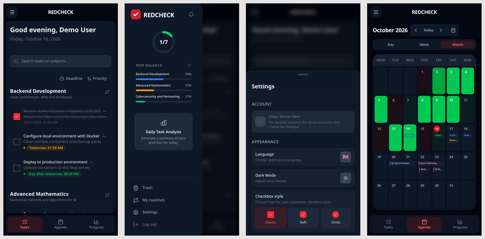

Most people open a productivity app on their phone, many times a day,
for a few seconds at a time. Until September, RedCheck was a desktop app
that technically loaded on a phone: the calendar alone had a hard-coded
minimum width of 700 pixels.

This post covers the work to make it feel like an app you'd install
rather than a website you'd tolerate, without writing a native app or
going through an app store.

## Step one: actually responsive

Below 640 px, the dashboard used to try to fit a sidebar, a calendar, a
task list and a stats panel side by side. It now works like a phone app:

- The sidebar becomes a drawer, opened with a hamburger button or an
  edge swipe and closed with a swipe back.
- The three main panels (calendar, tasks, progress) are shown one at a
  time, switched from a bottom tab bar.
- Every layout above 640 px stayed exactly as it was. Mobile got its own
  layout, desktop wasn't redesigned around it.

A small but important detail: the app height uses `100dvh` instead of
`100vh`. On mobile browsers, `100vh` ignores the address bar collapsing
and expanding, which pushed the bottom tab bar off screen.

## Why a PWA and not a native app

The request that started this was simple: "can we hide the browser's
address bar?". A web page can't, on purpose. If a script could hide the
real URL bar, a phishing page could draw a fake one.

The legitimate way to get there is to make the app installable. RedCheck
now ships a web app manifest, so "Add to Home Screen" gives you an icon
that launches it full screen, with no browser chrome. On top of that:

- **Shortcuts** on the home-screen icon (long-press: Today, Calendar,
  Settings).
- **An icon badge** with the number of pending tasks, using the Badging
  API where the platform supports it.
- **A status bar** that follows the light or dark theme.
- **Safe-area insets**, so nothing hides under the notch or the gesture
  bar.

The trade-off versus a native app is reach versus capability. A PWA is
one codebase, deployed instantly, with no review process. In exchange,
some things are harder, push notifications being the obvious one. More
on that below.

## Gestures, and getting them to feel right

Native apps feel native mostly because of gestures, so RedCheck now has
them:

- **Long-press** a task or subject to enter selection mode, then tap to
  add more, like a photo gallery. Deselecting the last one exits the
  mode.
- **Swipe a task right** to complete it, **left** to delete it.
- **Every modal is a bottom sheet** on mobile, dismissed by dragging its
  handle down. The exception is the command palette: a bottom sheet
  fights the on-screen keyboard, so it stays centred.
- **Pull to refresh** on the task list, because an installed PWA has no
  browser reload gesture at all.

Each of these took more iterations than I expected:

- The first swipe-to-dismiss stored the sheet's position in React state.
  Every `touchmove` triggered a full re-render, and on a heavy modal like
  Settings it visibly stuttered. The fix was to bypass React for the
  high-frequency part: move the sheet by writing its `transform` directly
  through a ref, batched with `requestAnimationFrame`, and only go back
  to React when the gesture ends.
- Dragging a sheet down also triggered Chrome's own pull-to-refresh and
  reloaded the app. `touch-action: none` on the handle wasn't enough,
  because pull-to-refresh is a document-level gesture.
  `overscroll-behavior-y: none` plus locking the page scroll while a
  modal is open finally fixed it.
- A long-press on a task's text raced the browser's native text
  selection, and often lost. Disabling text selection on those rows,
  only on touch devices, fixed it.
- React registers touch listeners as passive, so `preventDefault()` in an
  `onTouchMove` prop silently does nothing. Gestures that need to take
  over scrolling attach a real non-passive listener instead.

I also learned to gate touch-specific behaviour on *capability*, not
screen width. A narrow desktop window still has a mouse; a large tablet
still has no hover. Media queries like `(hover: none)` describe the input
device, which is what actually matters.

## The bugs only a real phone shows

Some bugs simply don't exist in desktop dev tools.

**Vibration.** Completing a task triggers a small haptic tick. It worked
on desktop emulation and did nothing on a real Android phone. The cause:
the Vibration API requires an active user gesture, and that gesture
context doesn't survive an `await`. The vibration was being called after
the API request resolved. Moving it to the first line of the click
handler fixed that. It still didn't buzz on one real phone, and from the
outside two causes look identical: the browser rejecting the call, or
accepting a 15 ms pulse too short for the motor to respond. So the pulse
went up to 40 ms, and instead of guessing again, Settings got a "Test
vibration" button that reports whether the browser accepted or rejected
the call.

**The colour-blind filter.** I added colour-blindness filters using SVG
colour matrices referenced from CSS. They shipped to production twice
with no visible effect at all. I never fully pinned down why (most likely
how browsers resolve SVG filter references on the root element), and
replaced them with plain CSS filter functions. That's not a satisfying
answer, but it is a working one, and I'd rather say that than pretend
otherwise.

**Font size.** The accessibility font-size setting changed the root font
size. Since almost every Tailwind spacing utility is also in `rem`, it
scaled padding, icons and card widths along with the text. It now scales
only the text-size tokens through a CSS variable.

## Push notifications: the honest version

Task reminders exist, but they're client-side: while RedCheck is open in
a tab or as an installed app, it checks every minute for tasks due in the
next 30 minutes and shows a notification. Real push notifications, which
reach you when the app is closed, need a service worker, VAPID keys and a
backend that triggers them. That's a proper project of its own, so I
shipped the lighter version and labelled it as such instead of
pretending otherwise.

## The rest of the polish

The same push brought a lot of smaller things, most of them on desktop
too: a command palette (Ctrl/Cmd+K), toasts instead of `alert()`, an
"Undo" toast on delete (which was cheap to build because every delete
already goes to the recycle bin from part 8), skeleton loading states,
a first-run tour, focus trapping in modals, `prefers-reduced-motion`
support, and personalised checkbox styles. Removing `framer-motion`,
which was used in exactly one place and whose exit animations never
actually ran, saved about 120 KB.

Not everything landed. One batch of spacing and size tweaks to the login
screen looked worse on a real phone and was reverted the same day.

## The bug that taught me the most

A CSS comment containing `animate-*/transition-*` closed itself early at
the `*/`, leaving the rest of the sentence to be parsed as CSS. The dev
server, the linter, the type checker and the tests all passed. Only the
production build failed. Every deploy after that commit failed silently
inside the Docker build, while I thought everything was shipping.

Since then, `npm run build` is part of the checklist before every push,
not something I trust the pipeline to tell me about.

## What I took away

- A PWA gets you most of the way to "native" for a fraction of the cost.
  Know which parts it can't do.
- Gestures need to bypass React for the frames that matter.
- Gate behaviour on input capability, not screen width.
- Test on a real device. Emulators don't vibrate.
- If the production build isn't in your local checklist, you don't know
  whether you're shipping.

Open [redcheckapp.com](https://redcheckapp.com/) on your phone, install
it to your home screen, and try to break it.
