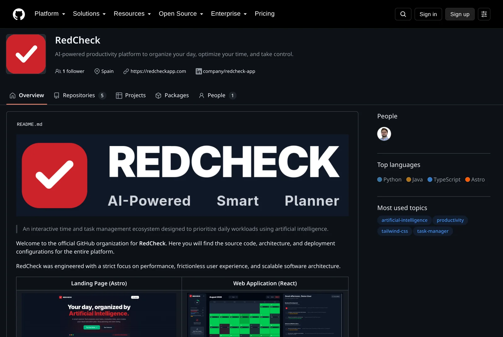

At the beginning of September, RedCheck's repositories went public. The
backend, the AI engine, the frontend and the landing page can now be read
by anyone on [GitHub](https://github.com/redcheckapp).

Flipping the visibility switch takes one click. Getting to the point
where I was comfortable flipping it took a couple of days of work that
had nothing to do with features, and taught me more about my own code
than most features do.

## Why open source at all

Three reasons, in order of honesty:

1. **It's my portfolio.** I'm looking for my first role as an engineer.
   "I built a production app with an AI service" is a claim. A public
   repository is evidence.
2. **It changes how I write code.** Knowing someone might read a file
   makes you name things better, delete dead code and write the comment
   that explains *why*. That effect starts the moment you decide to go
   public, not when someone actually reads it.
3. **It's a productivity tool.** People are understandably careful about
   where their task data goes. Being able to point at the code that
   handles it is worth something.

## Why AGPLv3 and not MIT

MIT was the default I considered first. It's simple and lets anyone do
almost anything. The problem is the "almost anything" part for a web
application: someone could take RedCheck, modify it, run it as a hosted
service and never share a line of their changes. Under most licences
that's fine, because they never *distribute* the software, they just run
it.

The GNU Affero GPL closes exactly that gap. If you run a modified
version as a network service, you have to offer its source to the users
of that service. For a self-hostable SaaS that's the property I want:
anyone can learn from it, self-host it or contribute to it, but nobody
can quietly turn it into a closed competitor.

The trade-off is real. Some companies have a blanket policy against
AGPL code, so it reduces how much it'll be reused commercially. For this
project, that's acceptable.

## Public release prep: the checklist

Before anything went public, I went through each repository as if I were
a reviewer seeing it for the first time.

### Secrets and configuration

- **The JWT signing key was hardcoded in the source.** It's now read
  from an environment variable. Moving it isn't enough on its own,
  though: the old value is still in the git history, which is about to be
  public. A secret that has ever been committed has to be treated as
  leaked and never used again.
- Database credentials, the AI engine URL and the allowed origins lost
  their convenient defaults in the configuration file. If a variable is
  missing, the app should fail at startup, not quietly connect to
  something with a default password.
- Hibernate's schema mode now defaults to `validate` instead of `update`
  unless an environment explicitly asks for more.

### CORS

Every controller had `@CrossOrigin(origins = "*")`, left over from the
day the React app first needed to call the API. Each one now reads the
allowed origins from configuration. Allowing any origin is a habit that
makes local development easy and is easy to forget, so I went through
every controller rather than trusting a global setting.

### Code a stranger can read

- Request and response DTOs became Java `record`s: immutable, with no
  Lombok boilerplate, and the intent is obvious at a glance.
- `System.out.println` became proper logging.
- Entity `equals`, `hashCode` and `toString` now exclude lazy
  relationships like the owning user. Including them is a classic way to
  trigger unexpected database loads or infinite recursion between two
  entities that reference each other.
- Developer comments and log messages, a lot of them in Spanish, were
  translated to English. The user-facing text stayed bilingual, of
  course.
- Build output had been committed to the repository at some point. It's
  gone, along with stale files, and `.gitignore` was cleaned up.

### The frontend's turn

The frontend had 24 ESLint errors and 11 TypeScript errors. Getting both
to zero wasn't cosmetic: one of them was a real bug, a function typed as
returning a single object while every caller treated the result as an
array. Strict tooling only helps if it's actually green.

The same pass split the single 697 kB JavaScript bundle into per-route
chunks and lazy-loaded the modals that only appear after a deliberate
click. The dashboard's own chunk went from 121 kB to 84 kB, and someone
who goes straight to the dashboard no longer downloads the login page's
animated background.

### Docs for humans

Each repository now has a README with an architecture diagram, setup
instructions and the licence, plus a `CONTRIBUTING.md` explaining the
standards and the pull-request workflow.

## What I took away

- Pick the licence for how your software is *used*, not just how it's
  distributed. For a web service, AGPL and MIT protect very different
  things.
- Treat any secret that was ever committed as public, even in a private
  repository.
- Defaults are decisions. A "convenient" default password is a
  vulnerability that looks like a feature.
- The best code review I've done on this project was the one where I
  imagined someone else reading it.

The code is at [github.com/redcheckapp](https://github.com/redcheckapp).
Issues, suggestions and pull requests are welcome.
