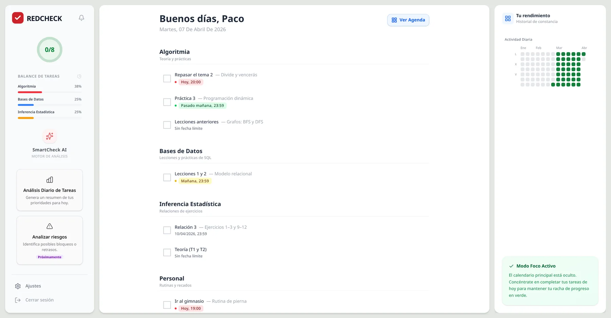

By 20 March RedCheck had a complete API and no interface at all
([part 2](/blog/redcheck-backend-first/)). On 21 March I created the
React project. Ten days later the dashboard had a calendar, a heatmap, a
focus mode and an AI button. This part is about those ten days.

A note on the screenshots: they aren't from back then. To get them, I
checked out the frontend exactly as it was on each date, ran it locally
and fed it sample data. What you see is the real code of that day, with
invented subjects and tasks.

## Day three: the notebook on a screen

React, TypeScript, Vite and Tailwind CSS. Login on day one, registration
on day two. On day three, 23 March, the first dashboard: a greeting, the
date, and the tasks grouped by subject, each with a checkbox and its
deadline.

It's plain, and it's very close to the sketch from
[part 1](/blog/redcheck-before-first-commit/), which was itself very close
to my notebook. All the HTTP calls lived in a small API layer from the
start, with an interceptor that attaches the JWT to every request. Since
the backend already existed and was documented, the frontend never had
to wait for an endpoint.

## What moved, and why

Over the following week the layout changed more than I expected, and the
sketch lost a few arguments with reality.

- **The calendar moved to the centre.** In the sketch it was a small
  month view tucked into the sidebar. Once each day showed how many tasks
  it held and how many were done, it was the most useful thing on the
  screen, and it deserved the space. The task list moved to a column on
  the right.
- **The sidebar became a dashboard of its own.** The progress circle
  stayed, and a "task balance" chart joined it: the three subjects with
  the most pending work, so you can see at a glance where to put the
  effort.
- **Overdue tasks got their own block.** In the notebook, an overdue
  task was simply copied to the next page, again and again. On screen, a
  task past its deadline moves to a separate "Out of time" section,
  still grouped by subject. It stays visible without polluting today's
  plan.
- **Dates became words.** Instead of `07/04/2026, 20:00`, a deadline
  reads "Today, 20:00" in red, "Tomorrow" in yellow or "The day after
  tomorrow" in green. Nobody should have to do date arithmetic to know
  what's urgent.

## A heatmap for consistency

The notebook could tell me how today was going. It couldn't tell me how
the last month had gone. That was the second thing I wanted from an app,
and the reason the backend stores a progress snapshot for every day.

The interface turns each snapshot into a colour, inspired by GitHub's
contribution graph: a day with nothing planned stays blank, a day where
nothing got done gets a faint red, and from there it goes through three
greens as the completion rate passes 50 % and 80 %. The month calendar
uses the same scale, so a good week literally looks green.

Focus Mode hides the calendar entirely and puts the heatmap next to
today's tasks: just the list and your track record, nothing else.

## Small decisions

- **No state library.** React's own hooks were enough: `useState` for
  the interface, plain state for what came from the server, and
  `useMemo` for derived data like today's tasks or the heatmap, so they
  only recompute when their inputs change. Redux or Zustand would have
  been one more thing to learn and maintain for no visible benefit at
  this size.
- **Components split late.** The dashboard started as one big file. On
  day four it split into `Sidebar`, `SubjectSection`, `TaskItem` and
  `OverdueSection`, once it was clear which pieces repeated. Splitting
  earlier would have meant guessing.
- **Motion, with a cost I didn't see yet.** On 27 March I added
  `framer-motion` for page transitions and small animations: a checkbox
  that pops, tasks that slide in and out. It made the app feel finished.
  It was also used in exactly one place, and its exit animations never
  actually ran. Removing it, months later, saved about 120 KB
  ([part 15](/blog/redcheck-native-feel/)).

## What I took from this stage

- A sketch is a hypothesis. The calendar moving to the centre wasn't a
  failure of the sketch, it was the first thing I learned by using the
  real thing.
- Having the API finished first paid off exactly as planned: ten days of
  pure interface work, with no backend detours.
- The details that make an app calm are cheap: words instead of dates,
  overdue tasks set aside instead of piled on top.

In the middle of those ten days, on 26 March, a new button appeared in
the sidebar: *Daily task analysis*. That's the next part.
