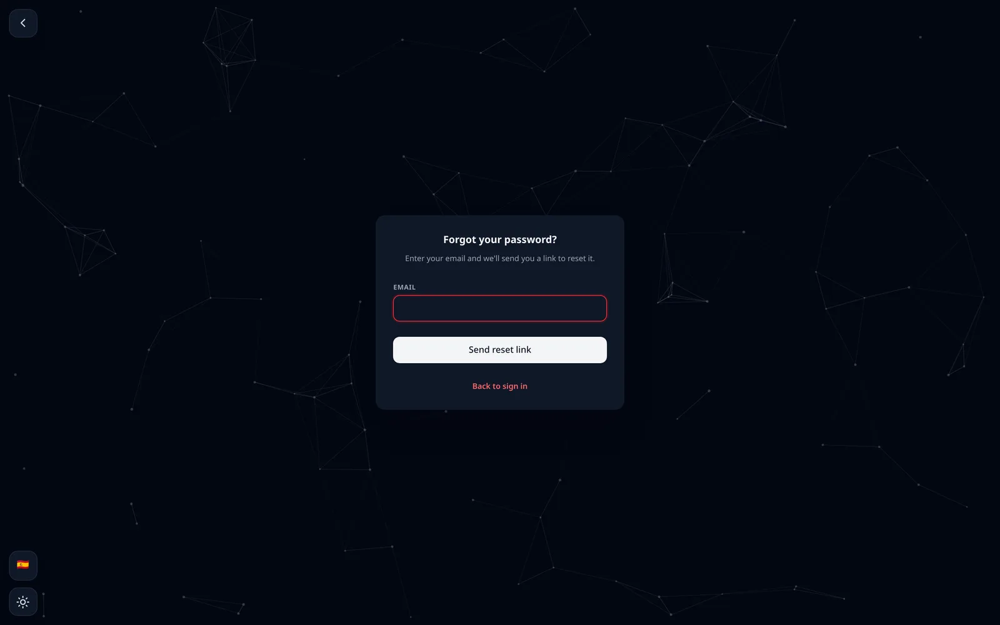
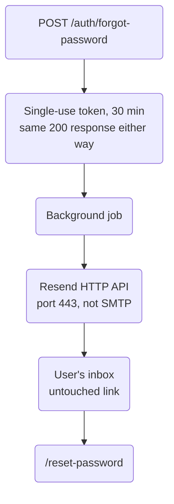

"Forgot your password?" is one of the most boring features in any app.
It's also one users expect without thinking, and RedCheck didn't have
it. If you forgot your password, your account was gone.

I expected to finish it in an afternoon. It took a day, two email
providers, a DNS record, a new deployment pipeline and some time on the
production server's command line. This post is the full story, because
almost none of the difficulty was in the code.

## The flow, and its security details

The design is standard:

1. `POST /auth/forgot-password` with an email address. If an account
   exists, the backend creates a random, single-use token that expires
   in 30 minutes and emails a link containing it.
2. The link opens a dedicated `/reset-password` page (a real URL, not a
   modal, because an email link needs somewhere to land).
3. `POST /auth/reset-password` with the token and the new password.

The details that matter:

- **The response is always the same.** Whether the email is registered
  or not, the endpoint answers `200` with the same message, and the
  frontend shows the same "check your inbox" screen. Otherwise the form
  becomes a tool for finding out who has an account.
- **Sending is asynchronous.** The email goes out in the background, so
  a slow or broken email provider never affects the response time, which
  would also leak whether the account exists.
- **Expired and used tokens are cleaned up** by an hourly job, the same
  pattern the recycle bin uses for its own cleanup.

In the same push, logged-in users got a "change password" option in
Settings. Accounts created with Google have no password at all, so for
them it becomes "set a password". The API also distinguishes "wrong
current password" (`400`) from "new password is the same as the current
one" (`409`), so the UI can explain which one happened. Login now accepts
either an email or a username, and a non-existent user produces exactly
the same error as a wrong password.

## Provider one: Brevo rewrote my links

The first provider I set up was Brevo, over SMTP. The email arrived. Then
I opened the raw message source in Gmail:

- Two tracking pixels had been injected.
- The reset link had been rewritten to go through Brevo's own redirect
  domain.
- A `List-Unsubscribe` header had been added, so Gmail treated it as bulk
  mail.

For a newsletter, that's a feature. For a password reset, it's
unacceptable: the link a user clicks to take control of their account
should go straight to my domain, not through a third party's tracking
redirect. As far as I could find, disabling it isn't self-service below
Brevo's enterprise tier.

I switched to Resend and checked the raw source again. The message
arrived exactly as sent: no pixels, no rewritten links.

The raw source also showed `DMARC: FAIL`, even though SPF and DKIM both
passed. The domain simply had no DMARC record. Adding one fixed it after
DNS propagation. If you send email from your own domain, check the raw
headers of what you send at least once. The rendered email can look
perfect while the headers tell a different story.

## Works locally, does nothing in production

Everything worked end to end on my machine. I deployed it, tried it in
production, and no email arrived. No error either.

**Problem one: the configuration never reached the server.** RedCheck's
`docker-compose.yml` lives in its own infrastructure repository (see
part 12). The backend and frontend each have a pipeline that builds an
image and restarts their own container. The infrastructure repository
had no pipeline at all. The compose file on the server was a plain copy
made by hand, so the new email environment variables I had added to the
repository never reached production.

The fix was structural, not a one-off copy: the infrastructure repository
now has its own deploy workflow. Any change to the compose file, the
nginx configuration or the database seed is copied to the server, and
`docker compose up -d` recreates only the services whose configuration
actually changed.

**Problem two: the server can't send email.** With the configuration
finally in place, emails still didn't arrive, and now the logs showed the
send hanging. From the server itself, I tested the SMTP ports one by
one with `openssl s_client` and `nc`. On every port (25, 465, 587, 2465,
2587), the TCP connection succeeded, and then the remote end never said
a word. No SMTP banner, just silence. The VPS provider silently blocks
outbound SMTP, which is common to prevent spam, and it would have broken
Brevo just the same. I had only ever tested SMTP from my laptop.

Asking the provider to unblock it, or trying more ports, would have been
fragile. The stack already makes outbound HTTPS calls to Gemini
without any problem, so the fix was to stop
using SMTP: emails are now sent through Resend's HTTP API on port 443.
The mail dependency and all the SMTP configuration were removed and
replaced by a single API key.

I also added an info-level log line before and after each send. The
original code only logged failures, which made "the background task
never ran" and "it ran and silently succeeded" look exactly the same.

After that, the whole flow worked in production: request, email, link,
new password, login.

## The hole I didn't think of

Right after shipping, a question occurred to me: RedCheck's demo
accounts share one public password that every visitor uses. What stopped
someone from changing it in Settings, or resetting it, and locking
everyone else out?

Nothing. Account deletion was already blocked for the demo accounts,
but the new password endpoints weren't. It's fixed now: changing the
password of a demo account returns `403`, requesting a reset for one
silently does nothing (so the response still doesn't reveal anything), and
a reset token belonging to a demo account is rejected anyway, as defence
in depth. The frontend disables the option too, but that's only
convenience; the backend is the actual enforcement.

The lesson I wrote down: every new endpoint that changes a user must
ask whether it applies to shared accounts. The original guard was a
single check in one controller, easy to miss when adding a sibling
feature.

## Sign in with Google: done, and blocked

I also built "Sign in with Google". The frontend gets an ID token from
Google, and the backend verifies it offline with Google's public keys,
with no client secret and no redirect flow, then links it to an existing
account by email or creates a new one. It only requests the basic
`openid`, `email` and `profile` scopes, which shouldn't need Google's app
verification.

It's in production, and the button is hidden. Earlier, while scoping
Google Calendar sync, I had added Calendar scopes to the same Google
Cloud project. Those *are* sensitive, and verification turns out to be
evaluated per project, not per login flow. The whole project was flagged
as "requires verification", every sign-in attempt failed with Google's
generic error page, and it stayed flagged even after I removed the
Calendar scopes. The button is behind a flag, so enabling it is a
one-line change once Google clears the project.

## What I took away

- Password reset is a security feature first: identical responses,
  short-lived single-use tokens, no third-party link rewriting.
- Read the raw headers of the emails you send.
- "Works locally" says nothing about your production network.
  Infrastructure has opinions you can't see from your laptop.
- If part of your system has no deploy pipeline, it isn't deployed. It's
  just a file someone copied once.
- Log successes in background jobs, not only failures.

Try it at [redcheckapp.com](https://redcheckapp.com/), ideally with a
password you're happy to forget.
