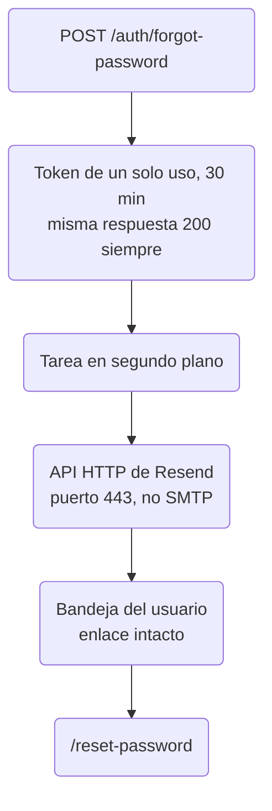

"¿Has olvidado tu contraseña?" es una de las funcionalidades más
aburridas de cualquier app. También es una que los usuarios dan por
hecha, y RedCheck no la tenía. Si olvidabas tu contraseña, tu cuenta
estaba perdida.

Pensaba terminarla en una tarde. Me llevó un día, dos proveedores de
correo, un registro DNS, un pipeline de despliegue nuevo y un buen rato
en la terminal del servidor de producción. Este post cuenta la historia
completa, porque casi nada de la dificultad estaba en el código.

## El flujo y sus detalles de seguridad

El diseño es el estándar:

1. `POST /auth/forgot-password` con una dirección de correo. Si existe
   una cuenta, el backend crea un token aleatorio de un solo uso que
   caduca en 30 minutos y envía por correo un enlace que lo contiene.
2. El enlace abre una página dedicada, `/reset-password` (una URL de
   verdad, no un modal, porque un enlace de un correo necesita un sitio
   donde aterrizar).
3. `POST /auth/reset-password` con el token y la nueva contraseña.

Los detalles que importan:

- **La respuesta es siempre la misma.** Esté registrado el correo o no,
  el endpoint responde `200` con el mismo mensaje, y el frontend muestra
  la misma pantalla de "revisa tu bandeja de entrada". Si no, el
  formulario se convierte en una herramienta para averiguar quién tiene
  cuenta.
- **El envío es asíncrono.** El correo sale en segundo plano, así que un
  proveedor lento o roto nunca afecta al tiempo de respuesta, que también
  delataría si la cuenta existe.
- **Los tokens caducados y usados se limpian** con una tarea cada hora,
  el mismo patrón que usa la papelera para su propia limpieza.

En la misma tanda, los usuarios con sesión iniciada recibieron la opción
de "cambiar contraseña" en Ajustes. Las cuentas creadas con Google no
tienen contraseña, así que para ellas la opción es "establecer una
contraseña". La API distingue además "contraseña actual incorrecta"
(`400`) de "la nueva contraseña es igual que la actual" (`409`), para que
la interfaz pueda explicar cuál de las dos ha pasado. El login ahora
acepta correo o nombre de usuario, y un usuario que no existe produce
exactamente el mismo error que una contraseña incorrecta.

## Primer proveedor: Brevo reescribía mis enlaces

El primer proveedor que configuré fue Brevo, por SMTP. El correo llegó.
Luego abrí el código fuente del mensaje en Gmail:

- Se habían inyectado dos píxeles de seguimiento.
- El enlace de restablecimiento se había reescrito para pasar por el
  dominio de redirección de Brevo.
- Se había añadido una cabecera `List-Unsubscribe`, así que Gmail lo
  trataba como correo masivo.

Para una newsletter, eso es una funcionalidad. Para un restablecimiento
de contraseña, es inaceptable: el enlace que pulsa un usuario para
recuperar el control de su cuenta debería ir directo a mi dominio, no
pasar por la redirección de seguimiento de un tercero. Por lo que pude
encontrar, desactivarlo no está al alcance del usuario por debajo del
plan enterprise de Brevo.

Me pasé a Resend y volví a revisar el código fuente. El mensaje llegó
exactamente como se envió: sin píxeles y sin enlaces reescritos.

El código fuente también mostraba `DMARC: FAIL`, aunque SPF y DKIM
pasaban los dos. El dominio simplemente no tenía registro DMARC. Añadirlo
lo arregló tras la propagación del DNS. Si envías correo desde tu propio
dominio, revisa al menos una vez las cabeceras en bruto de lo que envías.
El correo puede verse perfecto mientras las cabeceras cuentan otra
historia.

## Funciona en local, no hace nada en producción

Todo funcionaba de punta a punta en mi máquina. Lo desplegué, lo probé
en producción y no llegó ningún correo. Tampoco ningún error.

**Problema uno: la configuración nunca llegó al servidor.** El
`docker-compose.yml` de RedCheck vive en su propio repositorio de
infraestructura (ver parte 12). El backend y el frontend tienen cada uno
un pipeline que construye una imagen y reinicia su propio contenedor. El
repositorio de infraestructura no tenía ningún pipeline. El fichero
compose del servidor era una copia hecha a mano, así que las nuevas
variables de entorno del correo que había añadido al repositorio nunca
llegaron a producción.

La solución fue estructural, no una copia puntual: el repositorio de
infraestructura tiene ahora su propio workflow de despliegue. Cualquier
cambio en el fichero compose, la configuración de nginx o los datos
iniciales de la base de datos se copia al servidor, y
`docker compose up -d` recrea solo los servicios cuya configuración ha
cambiado de verdad.

**Problema dos: el servidor no puede enviar correo.** Con la
configuración ya en su sitio, los correos seguían sin llegar, y ahora los
logs mostraban el envío colgado. Desde el propio servidor probé los
puertos SMTP uno a uno con `openssl s_client` y `nc`. En todos (25, 465,
587, 2465 y 2587) la conexión TCP se establecía, y después el otro
extremo no decía ni una palabra. Ni banner SMTP, solo silencio. El
proveedor del VPS bloquea en silencio el SMTP saliente, algo habitual
para evitar spam, y habría roto Brevo igual. Yo solo había probado SMTP
desde mi portátil.

Pedirle al proveedor que lo desbloqueara, o probar más puertos, habría
sido frágil. El sistema ya hace llamadas HTTPS salientes a Gemini sin
ningún problema, así que la solución fue dejar de usar SMTP: los correos
se envían ahora a través de la API HTTP de Resend, por el puerto 443. Se
eliminaron la dependencia de correo y toda la configuración SMTP, y se
sustituyeron por una única clave de API.

También añadí una línea de log de nivel info antes y después de cada
envío. El código original solo registraba los fallos, lo que hacía que
"la tarea en segundo plano nunca se ejecutó" y "se ejecutó y salió bien
en silencio" fueran exactamente iguales.

Después de eso, todo el flujo funcionó en producción: petición, correo,
enlace, nueva contraseña, login.

## El agujero en el que no había pensado

Justo después de publicarlo se me ocurrió una pregunta: las cuentas demo
de RedCheck comparten una contraseña pública que usa todo visitante.
¿Qué impedía que alguien la cambiara en Ajustes, o la restableciera, y
dejara fuera a todos los demás?

Nada. Borrar las cuentas demo ya estaba bloqueado, pero los nuevos
endpoints de contraseña no. Ya está arreglado: cambiar la contraseña de
una cuenta demo devuelve `403`, pedir un restablecimiento para una no
hace nada en silencio (así la respuesta sigue sin revelar nada) y, aun
así, se rechaza cualquier token que pertenezca a una cuenta demo, como
defensa en profundidad. El frontend también desactiva la opción, pero eso
es solo comodidad; quien la hace cumplir de verdad es el backend.

La lección que apunté: cada endpoint nuevo que modifica un usuario tiene
que preguntarse si se aplica a cuentas compartidas. La protección
original era una sola comprobación en un controlador, fácil de pasar por
alto al añadir una funcionalidad hermana.

## Iniciar sesión con Google: hecho, y bloqueado

También construí "Iniciar sesión con Google". El frontend obtiene un ID
token de Google y el backend lo verifica sin conexión con las claves
públicas de Google, sin client secret y sin flujo de redirección, y
después lo vincula a una cuenta existente por correo o crea una nueva.
Solo pide los scopes básicos `openid`, `email` y `profile`, que no
deberían necesitar la verificación de apps de Google.

Está en producción, y el botón está oculto. Antes, al definir la
sincronización con Google Calendar, había añadido scopes de Calendar al
mismo proyecto de Google Cloud. Esos *sí* son sensibles, y resulta que la
verificación se evalúa por proyecto, no por flujo de login. Todo el
proyecto quedó marcado como "requiere verificación", cada intento de
inicio de sesión fallaba con la página de error genérica de Google, y
siguió marcado incluso después de quitar los scopes de Calendar. El botón
está detrás de un flag, así que activarlo es un cambio de una línea en
cuanto Google libere el proyecto.

## Con qué me quedo

- Restablecer la contraseña es ante todo una funcionalidad de seguridad:
  respuestas idénticas, tokens de un solo uso y corta duración, y nada de
  terceros reescribiendo enlaces.
- Lee las cabeceras en bruto de los correos que envías.
- "Funciona en local" no dice nada de tu red de producción. La
  infraestructura tiene opiniones que no ves desde tu portátil.
- Si una parte de tu sistema no tiene pipeline de despliegue, no está
  desplegada. Es solo un fichero que alguien copió una vez.
- En las tareas en segundo plano, registra también los éxitos, no solo
  los fallos.

Pruébalo en [redcheckapp.com](https://redcheckapp.com/), a ser posible
con una contraseña que no te importe olvidar.
