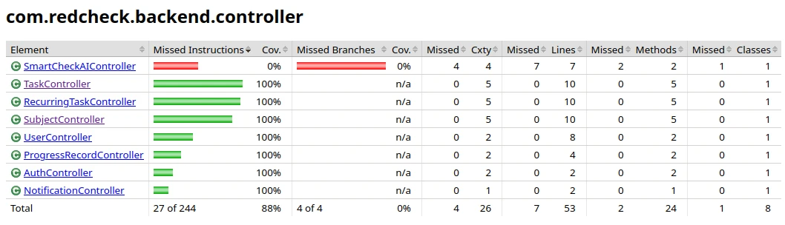

A principios de abril RedCheck hacía todo lo que me había propuesto: la
lista diaria de la libreta, tareas recurrentes, un mapa de calor, un
calendario y una IA que te planificaba el día
([parte 4](/es/blog/redcheck-smartcheck-v1/)). Funcionaba en una sola
máquina, la mía. Esta última parte de los inicios cuenta lo que hizo
falta para que funcionara en cualquier otra.

## Tests, a posteriori

Voy a ser sincero con el orden: los tests llegaron después del código.
Toda la batería entró en un solo día, el 31 de marzo, cuando el backend
ya había dejado de cambiar de forma.

- **Tests de servicios con Mockito.** Los repositorios se sustituyen por
  *mocks*, así que la lógica de negocio se ejecuta sin base de datos: el
  proceso que decide si generar una tarea recurrente, la foto diaria del
  progreso, las comprobaciones de propiedad.
- **Tests de controladores con MockMvc.** Peticiones HTTP completas
  contra la API, comprobando códigos de estado, el JSON que vuelve y que
  el filtro JWT deja pasar las peticiones correctas.
- **JaCoCo** para medir qué cubría realmente todo eso.

Los informes dicen la verdad, y la verdad tiene una franja roja: todo lo
relacionado con la IA estaba al 0 %. Era el código más nuevo, el menos
estable y el más difícil de probar, porque su salida viene de un modelo.
Lo sabía y seguí adelante. Visto ahora, es exactamente donde se escondía
el peor bug de la historia de RedCheck: el pipeline de RAG que nunca
escribía nada ([parte 11](/es/blog/redcheck-smartcheck-engine/)).

Escribir los tests a posteriori compensó de una forma que no esperaba.
Probar cada endpoint uno a uno me obligó a mirarlos todos, y dos
resultaron no usarse: obtener una sola tarea o una sola tarea recurrente
por id. El frontend nunca los llamaba, así que se borraron ese mismo día.
Menos código, menos que proteger.

## Contenedores

El 6 y el 7 de abril las dos mitades tuvieron su Dockerfile. El del
backend compila la aplicación de Spring Boot en una imagen. El del
frontend compila la app de React con Node y después sirve los archivos
estáticos con Nginx. Dos imágenes, cada una ejecutable en cualquier sitio
con Docker.

Un commit de esos días merece mención. Su mensaje dice *simplify build
script*. Lo que hizo en realidad fue cambiar `tsc -b && vite build` por
solo `vite build`: el build de producción dejó de ejecutar el compilador
de TypeScript, porque fallaba (seis errores, lo he comprobado) y la
imagen no se generaba. Funcionó, en el sentido de que la imagen se
generó. También significó que los errores de tipos podían acumularse sin
que nadie se diera cuenta, y se acumularon: cuando revisé el código antes
de publicarlo como código abierto, el frontend tenía 11 errores de
TypeScript ([parte 10](/es/blog/redcheck-open-source/)). Saltarse una
comprobación que falla no arregla nada. Solo aplaza la factura.

## Aprender a desplegar

Después aparqué el proyecto una temporada. Cuando lo retomé a finales de
mayo, fue con otra pregunta. Desplegar RedCheck nunca había estado en el
plan: para mí, la app estaba terminada. Pero nunca había puesto yo mismo
una aplicación real en internet, y quería saber cómo funciona eso de
verdad.

Aquel fin de semana, del 30 de mayo al 1 de junio, fue un curso
intensivo:

- **La configuración, fuera del código.** Las credenciales de la base de
  datos y otros valores que estaban escritos en el código para el
  desarrollo en local pasaron a variables de entorno. En un portátil,
  escribirlos en el código es cómodo. En un servidor, es una filtración
  esperando a ocurrir.
- **CORS, en serio.** Los orígenes permitidos pasaron a ser un ajuste en
  lugar de un atajo de desarrollo. Lo que no vi fue que cada controlador
  seguía llevando su propio `@CrossOrigin("*")` desde el primer día. Ese
  sobrevivió hasta la revisión para el código abierto, meses después.
- **Una demo en lugar de registros.** No estaba preparado para gestionar
  datos de usuarios reales, así que desactivé el registro y lo sustituí
  por una cuenta demo, creada automáticamente al arrancar, y un botón de
  "acceso rápido a la demo" en la pantalla de login. La cuenta demo no se
  puede borrar, para que el primer visitante no se la estropee al
  siguiente.
- **Un solo origen.** Hasta entonces el frontend llamaba al backend
  directamente en `localhost:8080`. En producción, Nginx empezó a
  reenviar las peticiones de la API al backend, así que el navegador solo
  habla con un dominio.
- **HTTPS, y dos funcionalidades rotas.** Al pasar a HTTPS, el mapa de
  calor y la IA dejaron de funcionar mientras todo lo demás iba bien. La
  causa estaba en esa nueva configuración de Nginx: en lugar de reenviar
  todo lo que cuelga de un prefijo de API, enumeraba cada ruta del
  backend por su nombre, y `/progress` y `/ai` no estaban en la lista.
  Dos arreglos de una línea, y una lección sobre la configuración que hay
  que mantener sincronizada con el código a mano.

## Con qué me quedo de los inicios

Mirando atrás a estas cinco partes:

- Una costumbre fue mejor especificación que cualquier documento de
  requisitos que hubiera podido escribir desde cero.
- Construir primero el backend fue lo acertado para una sola persona. La
  interfaz llevó diez días porque la API nunca la hizo esperar.
- Los atajos nunca salieron gratis. El 0 % de cobertura de la IA, el
  comprobador de tipos desactivado y el `@CrossOrigin("*")` olvidado
  volvieron todos, meses después, en forma de trabajo.
- Desplegar algo te enseña cosas que construirlo nunca te enseñará.

El 2 de junio de 2026 RedCheck salió a producción con su propio dominio.
Ahí empieza la siguiente etapa de esta serie: [RedCheck en
producción](/es/blog/redcheck-live/), la primera parte de *Ya en el mundo
real*.
