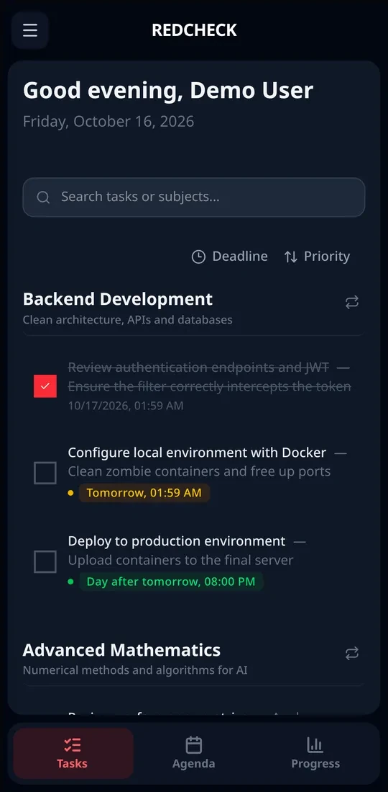
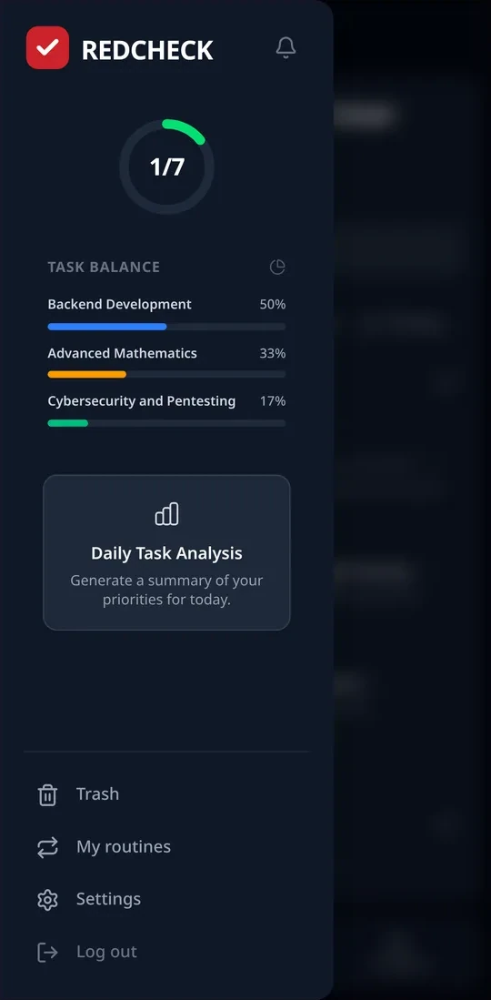
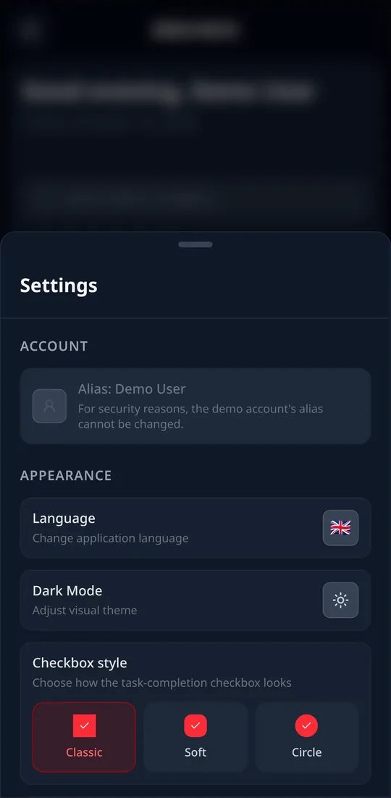
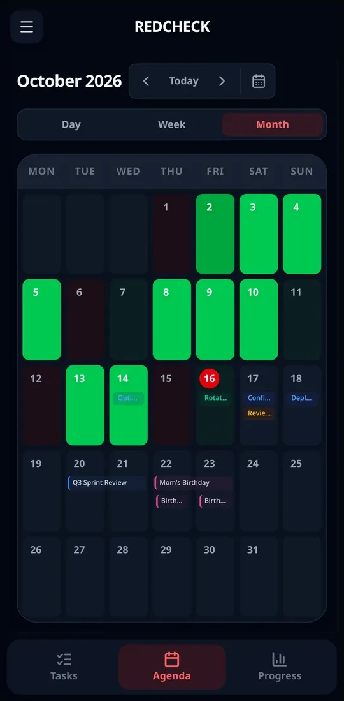

A principios del verano, con RedCheck recién salida a producción
([parte 6](/es/blog/redcheck-live/)), apunté lo que vendría después.
Cuatro líneas, cada una con una frase de descripción:

1. **Una app móvil nativa**: clientes para iOS y Android que reutilizan
   la API REST.
2. **Notificaciones push**: avisos de tareas a punto de vencer.
3. **Expresiones cron**: un motor para patrones de repetición complejos y
   personalizados.
4. **IA preventiva**: predecir atascos a partir del historial de
   rendimiento diario.

Estamos en octubre. Mirar esa lista ahora es más interesante de lo que
esperaba, porque casi todo lo que había en ella ha pasado, y casi nada ha
pasado como estaba escrito.

| Planeado en junio | Lo que pasó de verdad |
|---|---|
| Apps nativas para iOS y Android | Una web instalable con gestos nativos |
| Notificaciones push | Recordatorios mientras la app está abierta |
| Expresiones cron arbitrarias | Un cron restringido a propósito, y un caso a mano |
| IA preventiva a partir del mapa de calor | Aún sin construir, pero sus datos ya existen |

## Una app nativa se convirtió en una web que se siente nativa

El plan daba por hecho que "móvil" significaba nativa. La API REST ya
estaba separada de la interfaz, así que un cliente nativo parecía el
siguiente paso natural: el mismo backend, un frontend nuevo.

Lo que me hizo cambiar de idea fue hacer cuentas. Dos apps nativas son
dos bases de código más, dos revisiones de tienda de aplicaciones y cada
versión esperando la aprobación de otro. Una aplicación web progresiva es
una sola base de código, desplegada en cuanto hago push e instalable
desde el navegador.

Así que eso es lo que acabó siendo RedCheck
([parte 15](/es/blog/redcheck-native-feel/)): un manifiesto de aplicación
web, accesos directos en la pantalla de inicio, un globo en el icono con
tus tareas pendientes, hojas inferiores, deslizar para completar o
borrar, pulsación larga para seleccionar. El compromiso es alcance frente
a capacidad: funciona en todas partes, pero algunas cosas que las apps
nativas tienen gratis son más difíciles. Lo que lleva a la segunda línea.

## Las notificaciones push se convirtieron en recordatorios

"Avisos de tareas a punto de vencer" suena a una sola funcionalidad. En
realidad son dos. Mostrar una notificación mientras la app está abierta
es fácil. Llegar hasta ti cuando está cerrada necesita un service worker,
claves VAPID y un backend que decida cuándo enviar cada mensaje y a quién.

Publiqué la primera mitad y la llamé por su nombre: mientras RedCheck está
abierta, en una pestaña o instalada, comprueba cada minuto si hay tareas
que vencen en los próximos 30 minutos y muestra una notificación. El push
de verdad sigue siendo un proyecto en sí mismo. Y hay una opción que en
junio no existía: desde el trabajo de recuperación de contraseña
([parte 13](/es/blog/redcheck-password-reset/)), RedCheck puede enviar
correos de forma fiable, y un recordatorio por correo no necesita ningún
service worker.

## El cron se convirtió en un cron restringido

El plan decía "patrones complejos y personalizados". Cron puede expresar
casi cualquier cosa, así que guardar expresiones cron arbitrarias parecía
el motor evidente.

Cuando de verdad construí las rutinas personalizadas
([parte 14](/es/blog/redcheck-calendar/)), el problema no era expresar los
patrones, sino editarlos. Nadie quiere escribir `0 0 0 * * MON,THU`. Una
rutina tiene que poder editarse con casillas, y si la base de datos puede
guardar cualquier expresión cron, algunas nunca podrán convertirse de
vuelta en casillas. Así que RedCheck guarda cron, pero solo una forma
exacta, validada al entrar: días concretos de la semana. La versión
flexible habría sido más fácil de construir e imposible de usar.

Y un patrón no usa cron en absoluto. "El último día del mes" no tiene
operador en la implementación de cron de Spring, y la regla ingenua "día
31" se salta en silencio siete meses al año. Ese caso se resuelve a mano.

## La IA preventiva sigue en camino, y más cerca de lo que parece

La cuarta línea no se ha publicado. La tarjeta *Analizar riesgos* de la
barra lateral sigue diciendo "Próximamente", como desde la primera
versión de SmartCheck ([parte 4](/es/blog/redcheck-smartcheck-v1/)).

Pero el plan se equivocaba en una cosa, y descubrir por qué lo hizo
avanzar. Decía que la IA predeciría atascos a partir del historial de
rendimiento diario: el mapa de calor. El mapa de calor son los datos
equivocados. Cada día se guarda como una sola foto, un porcentaje, y ese
número ha olvidado qué tareas se retrasaron, de qué asignatura eran y
cuánto ([parte 2](/es/blog/redcheck-backend-first/)). Puedes ver que una
semana fue mala. No puedes ver por qué.

Los datos correctos aparecieron casi por accidente. Cuando SmartCheck se
convirtió en un servicio propio y descubrí que su memoria nunca se había
escrito ([parte 11](/es/blog/redcheck-smartcheck-engine/)), la solución
fue registrar el resultado de cada tarea. Hoy el motor guarda, por cada
asignatura, la tasa de finalización, el retraso medio en días y cuántas
veces sigues el orden que propuso la IA. Es exactamente lo que necesita
un aviso preventivo: "tus tareas de esta asignatura suelen terminar dos
días tarde, y tres vencen esta semana". La tarjeta sigue siendo un hueco.
La parte difícil que hay debajo ya no lo es.

## Con qué me quedo

- Una hoja de ruta nombra destinos. Las restricciones eligen el camino.
  Tres de cuatro líneas se publicaron, y cada una acabó siendo algo más
  pequeño, más concreto y más usable que la frase que la describía.
- "App nativa", "notificaciones push" y "cron" eran descripciones de
  soluciones, no de problemas. Los problemas eran: sentirse en casa en un
  móvil, que las fechas límite no te pillen por sorpresa, admitir rutinas
  reales. Resolverlos llevó a otro sitio.
- Lo que no se publicó no estaba bloqueado por falta de tiempo, sino por
  tener los datos equivocados. Los correctos aparecieron mientras
  arreglaba algo completamente distinto.

Ahora escribiré la siguiente lista, sabiendo que envejecerá igual.
