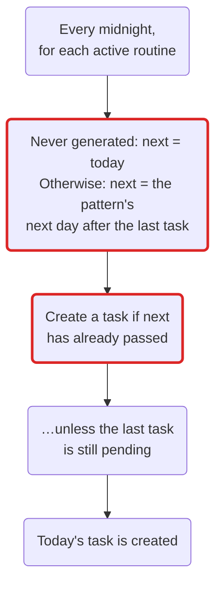
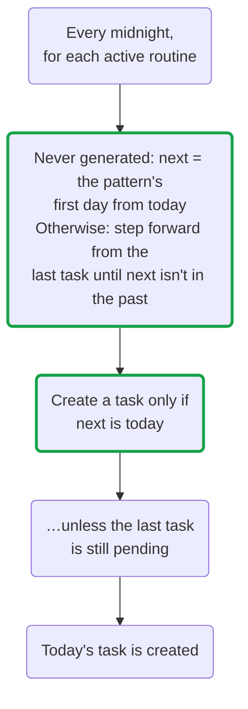

A RedCheck user reported that routines with custom days were creating
tasks on the wrong days. The report was short and completely right: a
routine meant for, say, Mondays and Thursdays could produce a task on a
day nobody had picked.

This post explains how routines work, the two pieces the scheduler was
missing, and the fix. The fix was one rule moved into one place.

## How a routine becomes a task

A routine is a template, not a task (that decision goes back to
[part 1](/blog/redcheck-before-first-commit/)). Every night at midnight,
a scheduler goes through the active routines and decides, for each one,
whether today gets a task.

The frequency is either a preset (daily, weekly, every two weeks,
monthly, yearly) or a custom pattern: specific weekdays, or a day of the
month like "the 15th" or "the last day". Custom weekdays are stored as a
deliberately restricted cron expression, `0 0 0 * * 1,4` for Mondays and
Thursdays ([part 16](/blog/redcheck-roadmap-revisited/) explains why it's
restricted). Each routine also remembers when it last generated a task,
and one rule from the very beginning still holds: if the previous task
is still pending, no new one is created, so a missed week never turns
into a pile of duplicates.

## How it worked before

Two of those steps were wrong, and both only showed up with custom
patterns. Presets have no "wrong day": any day is a valid start for
"daily" or "weekly".

**The first task ignored the pattern.** A routine that had never
generated anything got a task on the very next midnight. For a daily
routine, that's correct. For a "Mondays and Thursdays" routine created
on a Tuesday, it meant a task on Wednesday.

**"Has it passed?" is not "is it today?".** For every later task, the
scheduler worked out the pattern's next day after the last task and
generated as soon as that moment had passed. On a normal week, those
are the same question: the next day arrives, it has just passed, a task
appears. They stop being the same after a gap. Pause a routine for two
weeks and turn it back on during a Saturday: at midnight, the "next day"
is a Thursday from two weeks ago. It has certainly passed, so a task is
created on Sunday. Editing a routine's days, or a scheduler run missed
during a deploy, had the same effect.

## How it works now

Same steps, two of them changed:

- **The first task waits for the pattern.** A new routine starts on the
  first day its pattern selects. A preset still starts on the first
  midnight, as before.
- **The condition is "is it today?".** After a gap, the scheduler keeps
  stepping through the pattern from the last task until it reaches a day
  that isn't in the past. If that day is today, there's a task. If it's
  Monday, it waits for Monday. It also compares calendar days now, not
  timestamps down to the millisecond.

The pending rule is untouched. The old version also moved the "last
generated" date forward whenever it skipped a pending task; with the new
stepping that's no longer needed, so it's gone.

The same "Mondays and Thursdays" routine, before and after:

| Situation | Before | Now |
|---|---|---|
| Created on a Tuesday | First task on Wednesday | First task on Thursday |
| Paused for two weeks, back on a Saturday | Task on Sunday | Next task on Monday |
| A normal week | Monday and Thursday | Monday and Thursday |

That last row is why it took a while to notice: on an ordinary week,
both versions behave exactly the same.

## The same bug, twice more

Reviewing the fix turned up two more copies of the same logic.

**The calendar.** Recurring calendar events, like a weekly class or a
yearly birthday, were added later ([part 14](/blog/redcheck-calendar/)).
Their scheduler was written by mirroring the task scheduler, and it
inherited both bugs. A "Mondays and Thursdays" event created on a
Tuesday also appeared on Wednesday.

**The previews.** The routine editor shows the next few dates as you
pick days, and each routine shows its next occurrence. Both previews
had been written to mirror the scheduler, faithfully: the preview said
"Wednesday" too. The interface was consistent with the bug, which is
exactly why it didn't look like one.

Instead of fixing four places, the rule now lives in one function on the
backend: given a frequency, the date of the last task and a day, it
returns the routine's next occurrence on or after that day. Both
schedulers ask it "is the next occurrence today?", and both previews ask
it "what's the next occurrence from tomorrow?". The frontend's live
preview in the editor follows the same rule, with tests on both sides.

## The tests agreed with the bug

Some of the existing tests had to change, and not because they were
flaky. They asserted the old behavior. One expected the preview of a
"Mondays and Thursdays" routine to start on a Friday, with a comment
explaining that the first occurrence ignored the pattern on purpose.

A test proves the code does what the test says. If the test was written
from the code's behavior instead of from what users expect, it locks the
bug in. The fix added the cases that were missing: a first occurrence
that lands on a selected day, a gap that never fires on an unselected
one, a routine that already ran today, day 31 in a short month, and a
calendar event that follows the same rules as a task.

## What I took away

- "Has the date passed?" and "is the date today?" are the same question
  only until something interrupts the routine.
- When two pieces of code are written by copying one another, a bug
  copies itself too. One shared function is cheaper than remembering
  there are several.
- A preview that mirrors the logic will mirror its bugs, and make them
  look intentional.
- Read old tests as claims about behavior, not as proof that the
  behavior is right.

Routines with custom days now create tasks on the days you picked. If
yours ever doesn't, the feedback form in Settings is the fastest way to
tell me.
