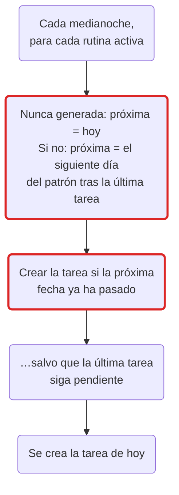
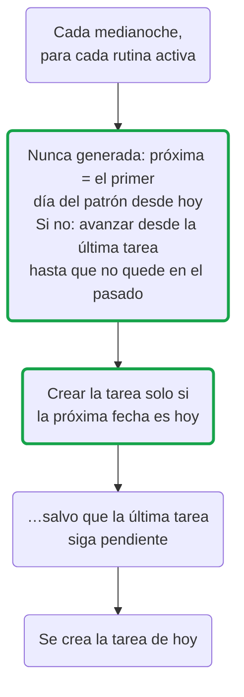

Un usuario de RedCheck avisó de que las rutinas con días personalizados
creaban tareas en días que no tocaban. El aviso era breve y tenía toda la
razón: una rutina pensada, por ejemplo, para los lunes y los jueves podía
generar una tarea en un día que nadie había elegido.

Este post explica cómo funcionan las rutinas, las dos piezas que le
faltaban al scheduler y el arreglo. El arreglo fue mover una regla a un
solo sitio.

## Cómo una rutina se convierte en tarea

Una rutina es una plantilla, no una tarea (esa decisión viene de la
[parte 1](/blog/redcheck-before-first-commit/)). Cada noche a las doce,
un scheduler recorre las rutinas activas y decide, para cada una, si hoy
le toca tarea.

La frecuencia es o bien un preset (diaria, semanal, cada dos semanas,
mensual, anual) o bien un patrón personalizado: días concretos de la
semana, o un día del mes como "el 15" o "el último día". Los días de la
semana personalizados se guardan como una expresión cron restringida a
propósito, `0 0 0 * * 1,4` para lunes y jueves (la
[parte 16](/blog/redcheck-roadmap-revisited/) explica por qué está
restringida). Cada rutina recuerda además cuándo generó su última tarea,
y una regla del principio sigue en pie: si la tarea anterior sigue
pendiente, no se crea otra, para que una semana olvidada no se convierta
en un montón de duplicados.

## Cómo funcionaba antes

Dos de esos pasos estaban mal, y los dos solo se notaban con patrones
personalizados. Los presets no tienen un "día equivocado": cualquier día
vale para empezar algo diario o semanal.

**La primera tarea ignoraba el patrón.** Una rutina que nunca había
generado nada recibía una tarea la siguiente medianoche. Para una rutina
diaria, eso es correcto. Para una de "lunes y jueves" creada un martes,
significaba una tarea el miércoles.

**"¿Ya ha pasado?" no es "¿es hoy?".** Para el resto de tareas, el
scheduler calculaba el siguiente día del patrón tras la última tarea y
generaba en cuanto ese momento había pasado. En una semana normal son la
misma pregunta: llega el día, acaba de pasar, aparece la tarea. Dejan de
serlo después de un hueco. Pausa una rutina dos semanas y vuelve a
activarla un sábado: a medianoche, la "próxima fecha" es un jueves de
hace dos semanas. Desde luego ya ha pasado, así que se crea una tarea el
domingo. Cambiar los días de una rutina, o una ejecución perdida durante
un despliegue, tenían el mismo efecto.

## Cómo funciona ahora

Los mismos pasos, con dos cambiados:

- **La primera tarea espera al patrón.** Una rutina nueva empieza el
  primer día que elige su patrón. Un preset sigue empezando la primera
  medianoche, como antes.
- **La condición es "¿es hoy?".** Después de un hueco, el scheduler va
  avanzando por el patrón desde la última tarea hasta llegar a un día que
  no esté en el pasado. Si ese día es hoy, hay tarea. Si es el lunes,
  espera al lunes. Además compara días del calendario, no marcas de
  tiempo al milisegundo.

La regla de la tarea pendiente no cambia. La versión anterior también
movía hacia delante la fecha de "última generación" cada vez que se
saltaba una tarea pendiente; con el nuevo avance ya no hace falta, así
que ha desaparecido.

La misma rutina de "lunes y jueves", antes y ahora:

| Situación | Antes | Ahora |
|---|---|---|
| Creada un martes | Primera tarea el miércoles | Primera tarea el jueves |
| Pausada dos semanas, reactivada un sábado | Tarea el domingo | Siguiente tarea el lunes |
| Una semana normal | Lunes y jueves | Lunes y jueves |

La última fila explica por qué costó verlo: en una semana corriente, las
dos versiones se comportan exactamente igual.

## El mismo bug, dos veces más

Al revisar el arreglo aparecieron dos copias más de la misma lógica.

**El calendario.** Los eventos recurrentes del calendario, como una clase
semanal o un cumpleaños anual, llegaron después
([parte 14](/blog/redcheck-calendar/)). Su scheduler se escribió
imitando al de tareas, y heredó los dos fallos. Un evento de "lunes y
jueves" creado un martes también aparecía el miércoles.

**Las vistas previas.** El editor de rutinas muestra las próximas fechas
mientras eliges los días, y cada rutina muestra su próxima ocurrencia.
Las dos vistas previas se escribieron imitando al scheduler, y con toda
fidelidad: la vista previa también decía "miércoles". La interfaz era
coherente con el bug, que es justo por lo que no parecía un bug.

En lugar de arreglar cuatro sitios, la regla vive ahora en una sola
función del backend: dada una frecuencia, la fecha de la última tarea y
un día, devuelve la próxima ocurrencia de la rutina a partir de ese día.
Los dos schedulers le preguntan "¿la próxima ocurrencia es hoy?", y las
dos vistas previas le preguntan "¿cuál es la próxima a partir de
mañana?". La vista previa en directo del editor, en el frontend, sigue
la misma regla, con tests en los dos lados.

## Los tests le daban la razón al bug

Hubo que cambiar algunos de los tests que ya existían, y no porque
fallaran a ratos. Comprobaban el comportamiento antiguo. Uno esperaba que
la vista previa de una rutina de "lunes y jueves" empezara en viernes,
con un comentario que explicaba que la primera ocurrencia ignoraba el
patrón a propósito.

Un test demuestra que el código hace lo que dice el test. Si el test se
escribió a partir de lo que hacía el código y no de lo que esperan los
usuarios, deja el bug fijado. El arreglo añadió los casos que faltaban:
una primera ocurrencia que cae en un día elegido, un hueco que nunca
genera en un día no elegido, una rutina que ya se ejecutó hoy, el día 31
en un mes corto y un evento del calendario que sigue las mismas reglas
que una tarea.

## Con qué me quedo

- "¿Ya ha pasado la fecha?" y "¿la fecha es hoy?" son la misma pregunta
  solo hasta que algo interrumpe la rutina.
- Cuando dos trozos de código se escriben copiando uno del otro, el bug
  también se copia. Una función compartida sale más barata que acordarse
  de que hay varias.
- Una vista previa que imita la lógica imita también sus bugs, y los hace
  parecer intencionados.
- Lee los tests antiguos como afirmaciones sobre el comportamiento, no
  como prueba de que el comportamiento es correcto.

Las rutinas con días personalizados crean ahora sus tareas los días que
elegiste. Si alguna vez la tuya no lo hace, el formulario de feedback de
Ajustes es la forma más rápida de contármelo.
