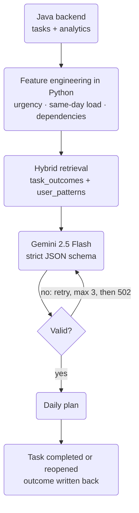

SmartCheck is the reason RedCheck exists. You give it your pending tasks
and it gives you back an ordered plan for the day, a risk level, and a
short explanation of why each task sits where it does.

Until the end of August, all of that lived inside the Spring Boot
backend. This post is about moving it out into its own service, and about
what I found when I looked closely at the retrieval part afterwards.
Short version: the architecture diagram was right, and the system it
described wasn't quite running.

## Where it started

The backend had an `AIService` interface with two implementations: one
calling Google's Gemini API, and one calling a local Llama model through
Ollama, selected by configuration. The backend built the prompt, sent
it, parsed the reply and stored the result. The request is asynchronous:
the frontend asks for a plan, the backend starts the analysis in the
background, and the client is notified when it's ready.

It worked, but every AI concern (prompting, retrieval, validation,
embeddings) was being written in Java, next to the code for tasks and
subjects. The tools I wanted for the next step, a vector store and the
Gemini SDK, are first-class in Python and second-class everywhere else.

## The split

`smartcheck-ai-engine` is a FastAPI service in its own container,
reachable only from inside the Docker network. The Java backend now does
three things:

1. Gathers the user's pending tasks plus some analytics (per-subject
   completion history) into one payload.
2. Sends it to the engine over an internal HTTP call.
3. Stores and serves the result.

Both the Gemini and Ollama implementations were deleted from the
backend. Choosing a model is now the engine's problem.

The trade-offs, as I see them:

- **Gained:** the right ecosystem for the job, an AI component that can
  be deployed, restarted and iterated on without touching the core API,
  and a backend that's back to doing backend things.
- **Paid:** one more container, one more network hop, and, most
  importantly, a contract between two languages that nothing enforces.
  Java sends JSON, Python reads JSON, and if a field name drifts on one
  side, nothing fails loudly. Keep that in mind for later.

## The engine's pipeline

The engine combines three inputs before it ever calls the model: the
current tasks, the user's history from a vector store (ChromaDB), and the
current date and time. Gemini 2.5 Flash then returns a structured JSON
plan, ranked across six dimensions: urgency, how much of the task could
be delegated to AI tools, the user's own history, cognitive effort,
dependencies between tasks, and balance across subjects.

That was the first version. Then I sat down to review it properly.

## The RAG had nothing to retrieve

Retrieval-augmented generation needs two paths: a read path that fetches
relevant history at query time, and a write path that stores that history
in the first place. The read path was implemented. **The write path did
not exist.** Nothing ever wrote to the vector store. Every plan had been
generated with an empty "history" section, and because the model still
produced a sensible-looking plan, nothing seemed wrong.

That's the uncomfortable thing about LLM systems: missing context
doesn't crash anything. It just quietly makes the output a bit more
generic.

So the redesign started there:

- **A task-outcome endpoint** on the engine. When a user completes or
  reopens a task, the backend now reports the outcome to it
  asynchronously: when it was due, when it was actually done, and so on.
  A failure there is logged and never rolls back the user's action. The
  task is the source of truth; the AI's memory is best-effort.
- **Two collections instead of one.** `task_outcomes` holds individual
  records, searched semantically. `user_patterns` holds one aggregated
  document per user and subject (completion rate, average delay, how
  often the user followed the suggested order), recomputed after every
  new outcome and looked up by exact match rather than similarity. Both
  are combined into a single labelled context block for the prompt.

## Don't make the model do arithmetic

Reading the prompt again, I noticed I was asking Gemini to work out how
many days were left until each deadline, which tasks fell on the same
day, and which tasks blocked others. Language models are not reliable at
date arithmetic, and there's no reason to ask them to be.

All of that is now computed in Python before the prompt is built: days
until due, an urgency bucket, same-day task density, and dependency
resolution. The prompt tells the model to trust those fields instead of
re-deriving them. The model's job is reduced to the part it's actually
good at: weighing those signals and explaining the result in plain
language.

## Retrieval that actually ranks

Taking ChromaDB's raw top three results by similarity wasn't good
enough. A very similar task from eight months ago is less predictive
than a slightly less similar one from last week. Retrieval now pulls a
wider pool of candidates and re-ranks them on three things: semantic
similarity, recency (with a smooth decay), and whether the subject
matches one of today's tasks.

While doing this I found that the collections had never been configured
for cosine distance. Chroma defaults to squared L2, and every diagram I'd
drawn said "cosine". Another silent one.

## Validate, retry, fail cleanly

The model is asked for a strict JSON schema, but "asked for" isn't
"guaranteed". Every response is now validated against the schema, not
just parsed as JSON, and the engine retries up to three times. If all
attempts fail, it returns a clean `502` instead of an unhandled
exception. The backend also refuses to start an analysis when there are
no pending tasks: asking the model to prioritise an empty list used to
leave the request hanging with nothing ever coming back.

## Bugs found along the way

Reviewing the two sides of the contract together turned up the kind of
bugs you only find by reading both:

- Field names assumed on the Python side didn't fully match what Java
  actually sent, so part of the retrieval query was being built from
  missing data. The fix was to check the real Java code instead of
  trusting a DTO that looked right.
- An early test had created a collection with a 4-dimensional
  embedding, on the real persistent store. Gemini's embeddings have
  3,072 dimensions. It would have broken retrieval in production,
  silently, the moment real data arrived. The collections were dropped
  and recreated.

Everything was then verified end to end against the real Gemini API, no
mocks: outcomes ingested, patterns aggregated, and a generated plan
whose reasoning correctly referred to that history.

## How it fits together now

The last step is the one that was missing: every outcome feeds the
store that the next plan reads from.

## What I deliberately didn't build

- **An agent loop.** Letting the model request more history through
  function calling is the obvious next step. It's also a much bigger
  change (multi-turn tool use, deciding which tools to expose), and
  single-shot retrieval already covers the common case. Deferred, not
  rejected.
- **Plan-level feedback.** I'd like to measure whether a whole day's plan
  was accurate, not just individual tasks. That needs a way to link task
  outcomes back to the plan they came from, and nothing tracks that yet.

## What I took away

- In a RAG system, check the write path first. An empty store looks
  exactly like a working one.
- Anything deterministic belongs in code, not in the prompt.
- Splitting services across languages is worth it, but the contract
  between them is now your problem. Read both sides.
- Validate structured output against its schema, and decide in advance
  what happens when it never validates.

The engine is open source:
[smartcheck-ai-engine](https://github.com/redcheckapp/smartcheck-ai-engine).
You can try SmartCheck with the demo account at
[redcheckapp.com](https://redcheckapp.com/).
