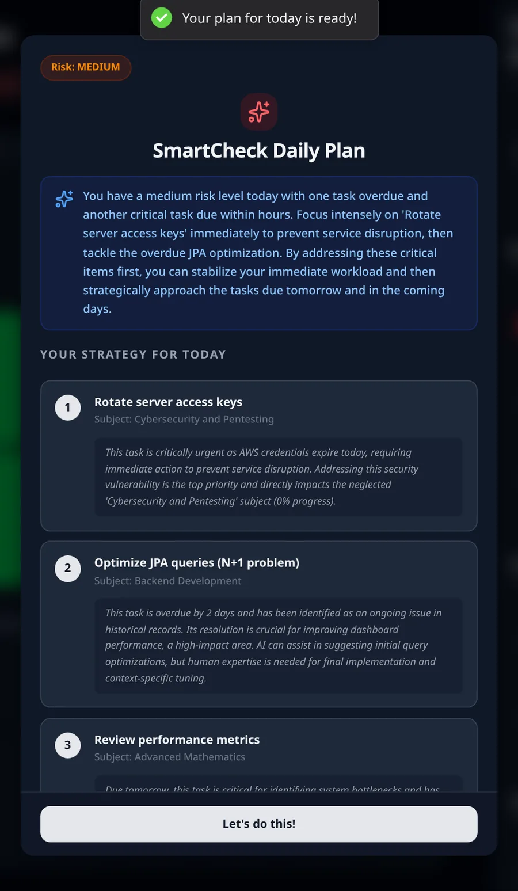
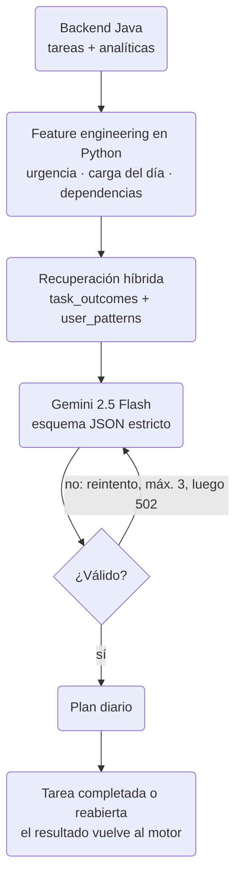

SmartCheck es la razón por la que existe RedCheck. Le das tus tareas
pendientes y te devuelve un plan ordenado para el día, un nivel de riesgo
y una breve explicación de por qué cada tarea está donde está.

Hasta finales de agosto, todo eso vivía dentro del backend de Spring
Boot. Este post trata de sacarlo a su propio servicio, y de lo que
encontré cuando miré con lupa la parte de recuperación. En resumen: el
diagrama de arquitectura estaba bien, y el sistema que describía no
estaba funcionando del todo.

## De dónde partía

El backend tenía una interfaz `AIService` con dos implementaciones: una
que llamaba a la API de Gemini de Google y otra que llamaba a un modelo
Llama local a través de Ollama, elegida por configuración. El backend
construía el prompt, lo enviaba, interpretaba la respuesta y guardaba el
resultado. La petición es asíncrona: el frontend pide un plan, el backend
lanza el análisis en segundo plano y se avisa al cliente cuando está
listo.

Funcionaba, pero toda la lógica de IA (prompts, recuperación,
validación, embeddings) se estaba escribiendo en Java, junto al código de
tareas y asignaturas. Las herramientas que quería para el siguiente
paso, una base de datos vectorial y el SDK de Gemini, son de primera
clase en Python y de segunda en todo lo demás.

## La separación

`smartcheck-ai-engine` es un servicio FastAPI en su propio contenedor,
accesible solo desde dentro de la red de Docker. El backend en Java ahora
hace tres cosas:

1. Reúne las tareas pendientes del usuario y algunas analíticas
   (historial de cumplimiento por asignatura) en un único payload.
2. Lo envía al motor mediante una llamada HTTP interna.
3. Guarda y sirve el resultado.

Las implementaciones de Gemini y Ollama se borraron del backend. Elegir
modelo ahora es problema del motor.

Los compromisos, tal y como yo los veo:

- **Lo que gané:** el ecosistema adecuado para el trabajo, un componente
  de IA que se puede desplegar, reiniciar y evolucionar sin tocar la API
  principal, y un backend que vuelve a hacer cosas de backend.
- **Lo que pagué:** un contenedor más, un salto de red más y, sobre todo,
  un contrato entre dos lenguajes que nada hace cumplir. Java envía JSON,
  Python lee JSON, y si el nombre de un campo cambia en un lado, nada
  falla de forma visible. Tenlo en mente para más adelante.

## El pipeline del motor

El motor combina tres entradas antes de llamar al modelo: las tareas
actuales, el historial del usuario guardado en una base de datos
vectorial (ChromaDB) y la fecha y hora actuales. Después, Gemini 2.5
Flash devuelve un plan en JSON estructurado, ordenado según seis
dimensiones: urgencia, cuánto de la tarea se podría delegar en
herramientas de IA, el historial del propio usuario, el esfuerzo
cognitivo, las dependencias entre tareas y el equilibrio entre
asignaturas.

Esa fue la primera versión. Luego me senté a revisarla en serio.

## El RAG no tenía nada que recuperar

La generación aumentada por recuperación (RAG) necesita dos caminos: uno
de lectura, que busca el historial relevante en el momento de la
consulta, y uno de escritura, que guarda ese historial en primer lugar.
El de lectura estaba implementado. **El de escritura no existía.** Nada
escribía nunca en la base de datos vectorial. Todos los planes se habían
generado con la sección de "historial" vacía y, como el modelo seguía
produciendo un plan razonable, nada parecía ir mal.

Eso es lo incómodo de los sistemas con LLM: que falte contexto no rompe
nada. Simplemente hace que la respuesta sea, sin que se note, un poco más
genérica.

Así que el rediseño empezó por ahí:

- **Un endpoint de resultados de tareas** en el motor. Cuando un usuario
  completa o reabre una tarea, el backend le informa del resultado de
  forma asíncrona: cuándo vencía, cuándo se hizo realmente, etc. Si eso
  falla, se registra en el log y nunca deshace la acción del usuario. La
  tarea es la fuente de verdad; la memoria de la IA es un "lo que se
  pueda".
- **Dos colecciones en lugar de una.** `task_outcomes` guarda registros
  individuales y se busca por similitud semántica. `user_patterns`
  guarda un documento agregado por usuario y asignatura (tasa de
  cumplimiento, retraso medio, cuántas veces siguió el orden sugerido),
  que se recalcula con cada resultado nuevo y se consulta por
  coincidencia exacta, no por similitud. Las dos se combinan en un único
  bloque de contexto etiquetado para el prompt.

## No pongas al modelo a hacer cuentas

Al releer el prompt me di cuenta de que le estaba pidiendo a Gemini que
calculara cuántos días faltaban para cada fecha límite, qué tareas caían
el mismo día y cuáles bloqueaban a otras. Los modelos de lenguaje no son
fiables con la aritmética de fechas, y no hay ninguna razón para
pedírselo.

Ahora todo eso se calcula en Python antes de construir el prompt: días
hasta el vencimiento, un nivel de urgencia, la densidad de tareas en el
mismo día y la resolución de dependencias. El prompt le indica al modelo
que se fíe de esos campos en lugar de volver a deducirlos. Su trabajo
queda reducido a lo que de verdad hace bien: sopesar esas señales y
explicar el resultado en lenguaje natural.

## Una recuperación que ordena de verdad

Quedarse con los tres primeros resultados por similitud que devuelve
ChromaDB no era suficiente. Una tarea muy parecida de hace ocho meses
predice peor que una algo menos parecida de la semana pasada. Ahora la
recuperación trae un conjunto más amplio de candidatos y los reordena
según tres criterios: similitud semántica, antigüedad (con un decaimiento
suave) y si la asignatura coincide con alguna de las tareas de hoy.

Haciendo esto descubrí que las colecciones nunca se habían configurado
para usar distancia coseno. Chroma usa por defecto la distancia L2 al
cuadrado, y todos los diagramas que había dibujado decían "coseno". Otro
fallo silencioso.

## Validar, reintentar y fallar limpiamente

Al modelo se le pide un esquema JSON estricto, pero "pedido" no es
"garantizado". Ahora cada respuesta se valida contra el esquema, no solo
se interpreta como JSON, y el motor reintenta hasta tres veces. Si todos
los intentos fallan, devuelve un `502` limpio en lugar de una excepción
sin controlar. El backend, además, se niega a lanzar un análisis cuando
no hay tareas pendientes: pedirle al modelo que priorizara una lista
vacía dejaba la petición colgada sin que llegara nunca nada.

## Bugs encontrados por el camino

Revisar los dos lados del contrato a la vez sacó a la luz el tipo de bug
que solo encuentras leyendo ambos:

- Los nombres de campo que asumía el lado de Python no coincidían del
  todo con lo que Java enviaba de verdad, así que parte de la consulta de
  recuperación se construía con datos que faltaban. La solución fue
  comprobar el código real de Java en lugar de fiarme de un DTO que
  parecía correcto.
- Un test antiguo había creado una colección con embeddings de 4
  dimensiones, sobre la base de datos persistente real. Los embeddings de
  Gemini tienen 3.072. Habría roto la recuperación en producción, en
  silencio, en cuanto llegaran datos reales. Las colecciones se borraron
  y se volvieron a crear.

Después se verificó todo de punta a punta contra la API real de Gemini,
sin mocks: resultados ingeridos, patrones agregados y un plan generado
cuyo razonamiento hacía referencia correctamente a ese historial.

## Cómo encaja todo ahora

El último paso es el que faltaba: cada resultado alimenta la base de
datos que lee el siguiente plan.

## Lo que decidí no construir

- **Un bucle de agente.** Dejar que el modelo pida más historial mediante
  function calling es el siguiente paso obvio. También es un cambio mucho
  mayor (uso de herramientas en varios turnos, decidir qué herramientas
  exponer), y la recuperación en un único paso ya cubre el caso habitual.
  Aplazado, no descartado.
- **Feedback a nivel de plan.** Me gustaría medir si el plan de un día
  entero acertó, no solo tareas sueltas. Para eso hace falta enlazar los
  resultados de las tareas con el plan del que salieron, y ahora mismo
  nada lo registra.

## Con qué me quedo

- En un sistema RAG, revisa primero el camino de escritura. Una base de
  datos vacía parece exactamente igual que una que funciona.
- Todo lo determinista va en el código, no en el prompt.
- Separar servicios en distintos lenguajes merece la pena, pero el
  contrato entre ellos pasa a ser tu problema. Lee los dos lados.
- Valida la salida estructurada contra su esquema, y decide de antemano
  qué pasa cuando nunca valida.

El motor es de código abierto:
[smartcheck-ai-engine](https://github.com/redcheckapp/smartcheck-ai-engine).
Puedes probar SmartCheck con la cuenta demo en
[redcheckapp.com](https://redcheckapp.com/).
