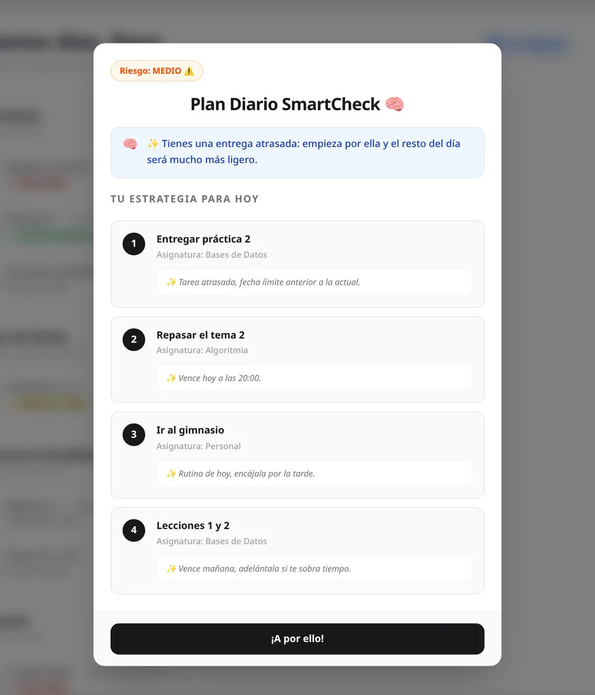
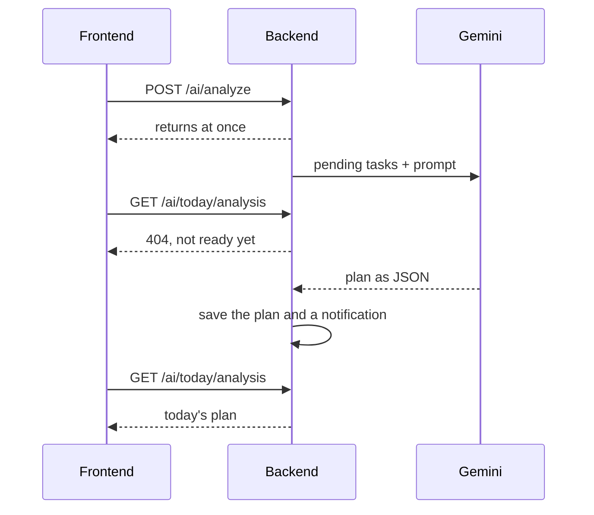
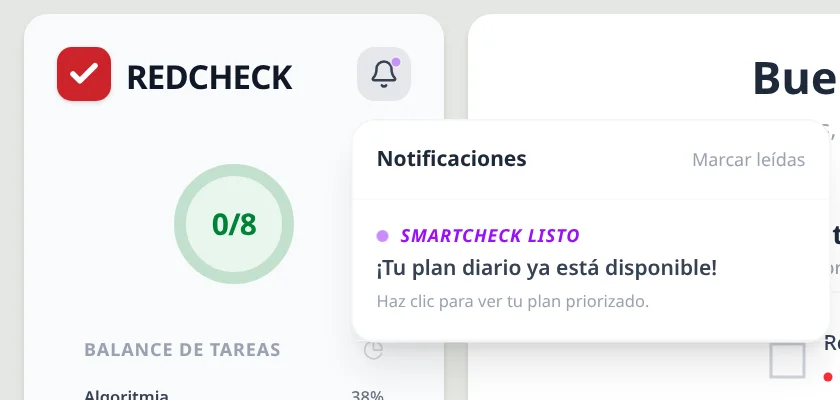

Nothing in my notebook could tell me what to do first. On a heavy day,
with three subjects and six deadlines, deciding the order was its own
small task. AI wasn't part of the original plan for RedCheck, but by late
March the core was working, and that question was the obvious next one:
given everything I have pending, what should I do today, and in what
order?

That became SmartCheck. This part covers its first version, built in a
week between 25 March and 1 April.

## Starting local

My first choice was to run the model myself, with Ollama and Llama 3.2
on my own machine. It's free, nothing leaves your computer, and there's
no API key to manage. For a planner holding someone's daily tasks, that
privacy argument is a real one.

It lasted about a week. Ollama took every resource my laptop had: while
it was generating a plan, the rest of the machine crawled. And the
laptop was the generous case. RedCheck was always going to run on a very
modest server, where a local model would compete for memory and CPU
with the backend, the frontend and the database, and lose.

So on 1 April SmartCheck moved to Google's Gemini API. The trade-off is
the mirror image of the one above: tasks now leave the server to be
processed by a third party, and every analysis has a cost and a
dependency on an external service. In exchange, the server does no heavy
lifting at all, and I could stop fighting hardware and focus on what
actually mattered: getting good, reliable answers out of the model.

## One interface, two providers

The switch took a day because the backend never talked to Ollama
directly. The service that builds the analysis depends on an interface
with a single method, `String ask(String prompt)`, and a configuration
value picks the implementation: `ollama` or `gemini`. Moving providers
meant writing `GeminiService`, making `OllamaService` implement the same
interface, and changing one line of configuration.

That interface cost almost nothing to add, and it's the reason the
switch was a config change instead of a rewrite.

## Getting JSON out of a language model

The interface needed structured data: an ordered list of tasks, each with
a reason, plus a risk level and a short message. Language models want to
chat. Ask for JSON and you'll often get *"Sure! Here's your plan:"*
followed by JSON, which breaks any parser.

Four things together made the output reliable enough:

- **Send only what matters.** The backend collects the user's pending
  tasks and sends just the id, title, description, deadline and subject
  of each. Fewer fields means fewer tokens, lower latency and less for
  the model to get distracted by.
- **A strict prompt.** It casts the model as a productivity analyst,
  lists explicit ordering rules (overdue first, then due today, then
  everything else) and spells out the exact JSON structure to return.
- **Low temperature.** At 0.2, the model picks the most likely tokens
  almost every time. For this job creativity is a bug: the same tasks
  should produce the same plan.
- **JSON mode.** Both providers can be told to return only JSON:
  `format: json` in Ollama, `responseMimeType: application/json` in
  Gemini. That removed the chatty preamble entirely.

One thing in that first prompt aged badly: it included the current date
and asked the model to work out which tasks were overdue or due today,
and to pick the risk level by counting them. It mostly worked. Months
later, when SmartCheck became its own service
([part 11](/blog/redcheck-smartcheck-engine/)), all of that moved into
code, because date arithmetic is exactly the kind of thing a model gets
quietly wrong.

## Waiting without blocking

The app warned that a plan "usually takes 15 to 20 seconds", and the
local model was slower than that. Holding an HTTP request open for that
long ties up a server thread and makes the interface hang. So the flow
is asynchronous:

The request starts the analysis in a background thread (`@Async`) and
returns immediately. When the plan is ready, the backend stores it and
records a notification. Meanwhile the frontend asks every three seconds
whether today's plan exists yet, and lights up the bell when it does.

The number of attempts went up twice in the commit history. The local
model was slow enough that the original limit kept timing out, and the
final value, 60 attempts, allows up to three minutes. Polling isn't
elegant: WebSockets or server-sent events would push the result instead
of asking for it. But it's a few lines of code, it works through any
proxy, and for a request a user makes a couple of times a day, it was the
right amount of engineering.

## A design that stayed on paper

Every analysis leaves a notification row behind. Over time, that's a
table full of "your plan is ready" messages nobody needs, so I designed
how to clean it up.

The first idea was a nightly cleanup job. The problem was time zones: a
job scheduled for 3 a.m. runs at 3 a.m. *server time*, and if the server
isn't in the user's time zone, it could delete unread notifications in
the middle of their afternoon. The design I settled on was to delete a
notification when it's read: the frontend sends a `DELETE` when you open
it, the table only ever holds what's still relevant, and there's no
scheduled job to get wrong.

That's the plan I wrote down. What actually shipped was simpler still.
The backend stored the notifications and exposed them, but the frontend
never read them: it already knew when polling found the plan, so it lit
the bell itself. Delete-on-read stayed a design, not code. It's a good
reminder that a decision documented is not a decision implemented.

## Honest placeholders

The sidebar had a second AI card from the start, *Risk analysis*, meant
to warn about patterns of delay before they become a problem. It never
got its logic in this version, and it says so: the card carries a "Coming
soon" label. I'd rather show what's planned and be clear it isn't there
yet than ship a button that pretends.

## What I took from this stage

- Local models are great until they share a machine with anything else.
  Know your hardware before you pick your architecture.
- A one-method interface between your code and the AI provider is the
  cheapest insurance you can buy.
- Reliable structured output from an LLM is a stack of small measures,
  not one trick: less input, strict instructions, low temperature, JSON
  mode.
- And don't ask the model to do arithmetic you could do in code. It took
  me a few months to fully learn that one.

The next part closes the beginnings: tests, Docker, and the road from my
laptop to a real server.
