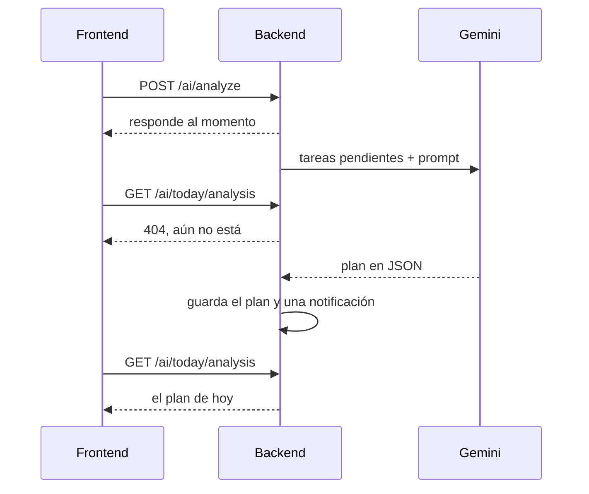

Nada en mi libreta podía decirme qué hacer primero. En un día cargado,
con tres asignaturas y seis fechas límite, decidir el orden era una
pequeña tarea en sí misma. La IA no estaba en el plan original de
RedCheck, pero a finales de marzo el núcleo ya funcionaba, y esa era la
pregunta evidente: con todo lo que tengo pendiente, ¿qué debería hacer
hoy, y en qué orden?

Así nació SmartCheck. Esta parte cuenta su primera versión, construida en
una semana, entre el 25 de marzo y el 1 de abril.

## Empezar en local

Mi primera opción fue ejecutar el modelo yo mismo, con Ollama y Llama 3.2
en mi propio ordenador. Es gratis, nada sale de tu máquina y no hay
ninguna API key que gestionar. Para un planificador que guarda las tareas
diarias de alguien, ese argumento de privacidad pesa.

Duró una semana. Ollama se comía todos los recursos de mi portátil:
mientras generaba un plan, todo lo demás iba a rastras. Y el portátil era
el caso generoso. RedCheck iba a acabar en un servidor muy modesto, donde
un modelo local competiría por memoria y CPU con el backend, el frontend
y la base de datos, y perdería.

Así que el 1 de abril SmartCheck pasó a la API de Gemini de Google. El
compromiso es el reflejo exacto del anterior: ahora las tareas salen del
servidor para que las procese un tercero, y cada análisis tiene un coste
y depende de un servicio externo. A cambio, el servidor no hace ningún
trabajo pesado, y pude dejar de pelearme con el hardware para centrarme
en lo que de verdad importaba: conseguir respuestas buenas y fiables del
modelo.

## Una interfaz, dos proveedores

El cambio llevó un día porque el backend nunca habló con Ollama
directamente. El servicio que prepara el análisis depende de una interfaz
con un único método, `String ask(String prompt)`, y un valor de
configuración elige la implementación: `ollama` o `gemini`. Cambiar de
proveedor fue escribir `GeminiService`, hacer que `OllamaService`
implementara la misma interfaz y cambiar una línea de configuración.

Esa interfaz no costó casi nada añadirla, y es la razón de que el cambio
fuera de configuración y no una reescritura.

## Sacarle JSON a un modelo de lenguaje

La interfaz necesitaba datos estructurados: una lista ordenada de tareas,
cada una con su motivo, más un nivel de riesgo y un mensaje corto. Los
modelos de lenguaje quieren charlar. Pídeles JSON y a menudo te darán
*"¡Claro! Aquí tienes tu plan:"* seguido del JSON, lo que rompe cualquier
parser.

Cuatro medidas juntas hicieron la respuesta lo bastante fiable:

- **Enviar solo lo que importa.** El backend recoge las tareas pendientes
  del usuario y envía solo el id, el título, la descripción, la fecha
  límite y la asignatura de cada una. Menos campos significa menos
  tokens, menos latencia y menos cosas con las que distraer al modelo.
- **Un prompt estricto.** Le asigna el papel de analista de
  productividad, enumera reglas de orden explícitas (primero lo atrasado,
  luego lo que vence hoy, luego el resto) y detalla la estructura JSON
  exacta que debe devolver.
- **Temperatura baja.** Con 0,2, el modelo elige casi siempre los tokens
  más probables. Para este trabajo la creatividad es un fallo: las mismas
  tareas deberían dar el mismo plan.
- **Modo JSON.** A los dos proveedores se les puede pedir que devuelvan
  solo JSON: `format: json` en Ollama, `responseMimeType:
  application/json` en Gemini. Eso eliminó por completo el preámbulo
  charlatán.

Una cosa de aquel primer prompt envejeció mal: incluía la fecha actual y
le pedía al modelo que averiguara qué tareas estaban atrasadas o vencían
hoy, y que eligiera el nivel de riesgo contándolas. Casi siempre
funcionaba. Meses después, cuando SmartCheck se convirtió en un servicio
propio ([parte 11](/es/blog/redcheck-smartcheck-engine/)), todo eso pasó
al código, porque la aritmética de fechas es justo el tipo de cosa en la
que un modelo se equivoca sin avisar.

## Esperar sin bloquear

La app avisaba de que un plan "suele tardar unos 15-20 segundos", y el
modelo local tardaba más. Mantener abierta una petición HTTP tanto tiempo
ocupa un hilo del servidor y deja la interfaz colgada. Así que el flujo
es asíncrono:

La petición lanza el análisis en un hilo en segundo plano (`@Async`) y
responde al instante. Cuando el plan está listo, el backend lo guarda y
registra una notificación. Mientras tanto, el frontend pregunta cada tres
segundos si ya existe el plan de hoy, y enciende la campana cuando lo
encuentra.

El número de intentos subió dos veces en el historial de commits. El
modelo local era tan lento que el límite original se agotaba una y otra
vez, y el valor final, 60 intentos, permite esperar hasta tres minutos.
El *polling* no es elegante: con WebSockets o server-sent events el
servidor enviaría el resultado en lugar de esperar a que se lo pidan.
Pero son unas pocas líneas, funciona a través de cualquier proxy, y para
una petición que un usuario hace un par de veces al día, era la cantidad
justa de ingeniería.

## Un diseño que se quedó en el papel

Cada análisis deja atrás una fila de notificación. Con el tiempo, eso es
una tabla llena de mensajes de "tu plan está listo" que nadie necesita,
así que diseñé cómo limpiarla.

La primera idea fue un proceso de limpieza cada noche. El problema eran
las zonas horarias: un proceso programado para las 3 de la madrugada se
ejecuta a las 3 *hora del servidor*, y si el servidor no está en la zona
horaria del usuario, podría borrar notificaciones sin leer en mitad de su
tarde. El diseño por el que me decidí fue borrar cada notificación al
leerla: el frontend envía un `DELETE` al abrirla, la tabla solo guarda lo
que sigue siendo relevante y no hay ningún proceso programado que pueda
fallar.

Ese es el plan que dejé escrito. Lo que se publicó fue todavía más
sencillo. El backend guardaba las notificaciones y las exponía, pero el
frontend nunca las leía: ya sabía cuándo el *polling* encontraba el plan,
así que encendía la campana él solo. El borrado al leer se quedó en
diseño, no en código. Es un buen recordatorio de que una decisión
documentada no es una decisión implementada.

## Huecos honestos

La barra lateral tuvo desde el principio una segunda tarjeta de IA,
*Analizar riesgos*, pensada para avisar de patrones de retraso antes de
que se conviertan en un problema. En esta versión nunca tuvo lógica
detrás, y lo decía: la tarjeta llevaba la etiqueta "Próximamente".
Prefiero enseñar lo que está planeado y dejar claro que aún no existe que
publicar un botón que finge.

## Con qué me quedo de esta etapa

- Los modelos locales son geniales hasta que comparten máquina con
  cualquier otra cosa. Conoce tu hardware antes de elegir tu
  arquitectura.
- Una interfaz de un solo método entre tu código y el proveedor de IA es
  el seguro más barato que puedes contratar.
- Una salida estructurada fiable de un LLM es un conjunto de pequeñas
  medidas, no un único truco: menos entrada, instrucciones estrictas,
  temperatura baja, modo JSON.
- Y no le pidas al modelo cuentas que puedes hacer en código. Esa me
  costó unos meses aprenderla del todo.

La siguiente parte cierra los inicios: tests, Docker y el camino de mi
portátil a un servidor de verdad.
