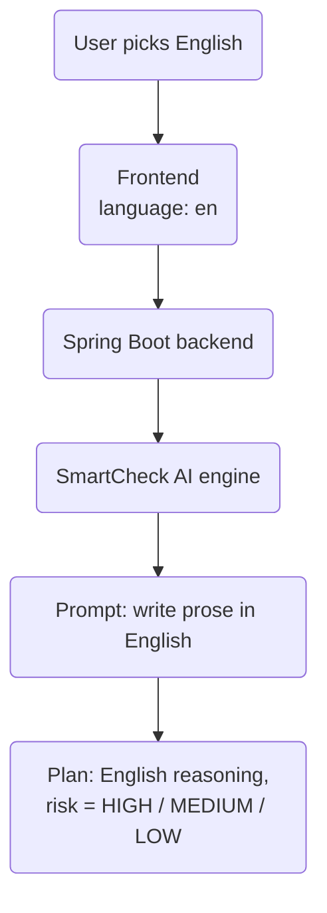

Until late August, RedCheck had exactly one kind of user in mind: a
Spanish speaker, on a laptop, in light mode. That's fine for a side
project. It's not fine for something you put on your LinkedIn and ask
strangers to try.

This post covers the week where I fixed that: dark mode, a full
English/Spanish version (including the AI), the legal pages any app
handling personal data in the EU needs, and the cookies that hold it all
together. None of it is a headline feature. All of it is the difference
between "a demo" and "a product someone else can use".

## Dark mode first

I started with dark mode because it touches every component, and I wanted
to find out how consistent the styling really was before adding a second
language on top.

The approach is the usual one: a `ThemeContext` that toggles a `dark`
class on the root element, and Tailwind's `dark:` variants everywhere.
The part that's easy to get wrong is the first paint. If the theme is
only read once React mounts, a dark-mode user sees a white flash on every
load. The fix is a tiny inline script in `index.html` that reads the
stored preference and sets the class *before* anything renders. It's ten
lines and it's the most important ten lines of the feature.

The honest finding: going through every component in dark mode exposed
how much styling had been copy-pasted with slightly different greys,
borders and hover states. Dark mode didn't create those inconsistencies,
it just made them visible.

## Two languages without an i18n library

The obvious choice was `i18next` or `react-intl`. I didn't use either.

RedCheck has two languages, no pluralisation rules more complex than
"1 task / 2 tasks", and no translators other than me. So each component
owns a small `translations` object with an `es` and an `en` key, and a
`LanguageContext` decides which one is active. The language is resolved
in this order:

1. A shared cookie (more on that below).
2. `localStorage`, for users who had chosen a language before the
   cookie existed.
3. The browser's `navigator.language`.
4. Spanish, as the default.

The trade-off is clear and I accepted it on purpose:

- **What I gained:** zero dependencies, no loading of translation
  bundles, and the text lives right next to the component that uses it,
  so changing a screen means touching one file.
- **What I gave up:** there's no central catalogue. If I ever add a
  third language, or someone else wants to translate, I'll have to
  extract everything into proper resource files. That day, a library
  will earn its place. Today it wouldn't.

One small React lesson from this: the dashboard loads its data once on
mount. The linter wanted the translation function in that effect's
dependency list, which would have meant refetching every task and subject
every time someone toggled the language. I left it out deliberately and
documented why. Lint rules are a good default, not a law.

## The AI has to speak English too

Translating the UI is the easy half. RedCheck's main feature is
SmartCheck, which generates a prioritised plan for your day with a short
explanation for each task. If the interface is in English and the plan
comes back in Spanish, the translation is worthless.

So the user's language now travels with the request: frontend to
backend, backend to the AI engine, and into the prompt. The model writes
its reasoning in the user's language.

The decision that mattered here was *what* to let the model translate.
Free text (the reasoning, the support message) is written in the user's
language. Machine-readable fields like the risk level are **not**: they
are fixed English values (`HIGH`, `MEDIUM`, `LOW`) and the frontend
translates them into labels. If the model were allowed to return
"ALTO" sometimes and "HIGH" other times, every consumer of that response
would need to handle both. Keeping structured output language-neutral
keeps the contract stable.

## A demo account per language

RedCheck has a "try the demo" button so nobody has to register just to
look around. With two languages, a single demo account stopped making
sense: an English visitor landing on a dashboard full of Spanish
subjects and task names gets a terrible first impression.

There are now two demo accounts, one seeded with Spanish content and one
with English content, and the button picks one based on the current UI
language. Both are reset to a known state every hour by a scheduled
event in MySQL, and both are protected from deletion: they're shared,
public identities, so nobody should be able to delete the account
everyone else is about to log into. (That protection turned out to be
incomplete, but that's a story for a later post in this series.)

## GDPR: terms, privacy and honest cookies

RedCheck stores personal data: emails, tasks, and task history that the
AI uses. In the EU that means real Terms of Service and a real Privacy
Policy, not a placeholder link. Both pages exist now, in both languages.

The cookie section is short, and I'm glad it is. RedCheck doesn't use
analytics or advertising cookies. The only cookies it sets hold two
preferences: the theme and the language. Being able to write that
sentence plainly in the privacy policy is a design decision in itself:
every tracking script I didn't add is a paragraph I don't have to
justify.

## Why a cookie and not just localStorage

The reason those two preferences live in a cookie is that RedCheck is
now split across two sites: the landing page at `redcheckapp.com` and
the app at `my.redcheckapp.com` (part 7 is about that split).
`localStorage` is scoped to a single origin, so a visitor who picks
English and dark mode on the landing page would arrive at the login
screen in Spanish and light mode. A cookie scoped to the parent domain
can be read from both.

## What I took away

- Dark mode is a styling audit in disguise.
- Choose your i18n tooling for the languages you have, not the ones you
  might have. Just know what it'll cost to change your mind.
- When an LLM's output feeds code, let it translate prose, never enums.
- Demo data deserves the same care as real data: it's the first thing
  most visitors will see.
- The cheapest privacy policy to write is the one for an app that
  doesn't track people.

You can switch languages and themes at
[redcheckapp.com](https://redcheckapp.com/), or try either demo account
directly.
