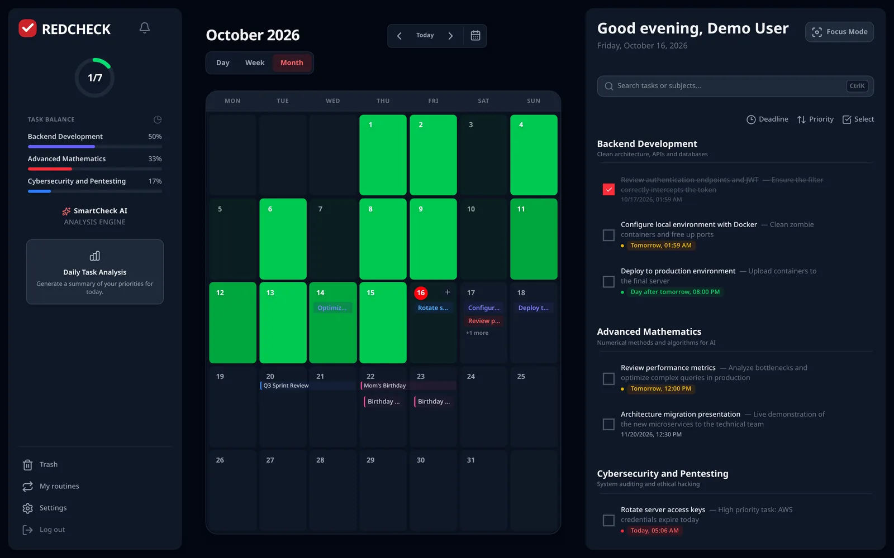
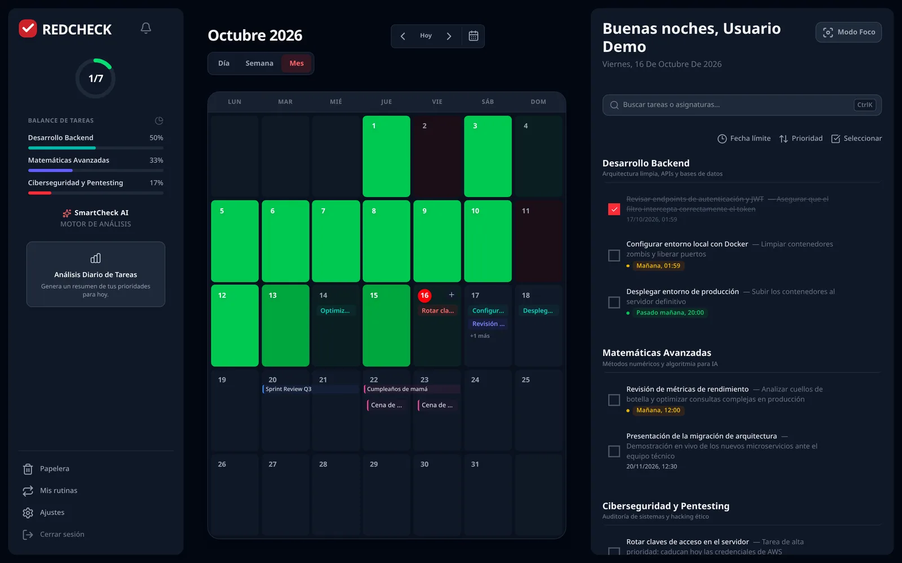
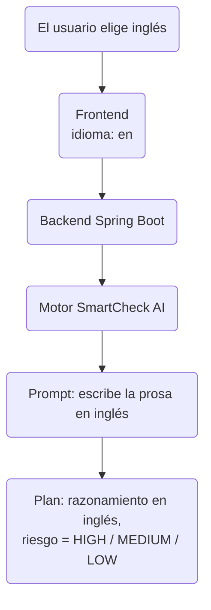

Hasta finales de agosto, RedCheck tenía en mente un único tipo de
usuario: alguien que habla español, con un portátil y en modo claro.
Para un proyecto personal, vale. Para algo que pones en LinkedIn y le
pides a desconocidos que prueben, no.

Este post cuenta la semana en la que lo arreglé: modo oscuro, una versión
completa en inglés y español (también la IA), las páginas legales que
necesita cualquier app que trate datos personales en la UE y las cookies
que lo mantienen todo unido. Nada de esto es una funcionalidad estrella.
Todo ello es la diferencia entre "una demo" y "un producto que otra
persona puede usar".

## Primero, el modo oscuro

Empecé por el modo oscuro porque toca todos los componentes, y quería
saber hasta qué punto los estilos eran coherentes antes de meter un
segundo idioma encima.

El enfoque es el habitual: un `ThemeContext` que activa una clase `dark`
en el elemento raíz y variantes `dark:` de Tailwind por todas partes. La
parte fácil de hacer mal es el primer pintado. Si el tema solo se lee
cuando React se monta, quien usa el modo oscuro ve un fogonazo blanco en
cada carga. La solución es un pequeño script en línea en `index.html` que
lee la preferencia guardada y pone la clase *antes* de que se renderice
nada. Son diez líneas y son las diez líneas más importantes de la
funcionalidad.

Lo que descubrí, siendo sincero: repasar cada componente en modo oscuro
dejó a la vista cuántos estilos se habían copiado y pegado con grises,
bordes y estados hover ligeramente distintos. El modo oscuro no creó esas
incoherencias; solo las hizo visibles.

## Dos idiomas sin librería de i18n

Lo obvio era usar `i18next` o `react-intl`. No usé ninguna.

RedCheck tiene dos idiomas, ninguna regla de plurales más compleja que
"1 tarea / 2 tareas" y ningún traductor aparte de mí. Así que cada
componente tiene su propio objeto `translations` con una clave `es` y otra
`en`, y un `LanguageContext` decide cuál está activa. El idioma se
resuelve en este orden:

1. Una cookie compartida (más sobre esto abajo).
2. `localStorage`, para quien ya había elegido idioma antes de que
   existiera la cookie.
3. El `navigator.language` del navegador.
4. Español, por defecto.

El compromiso está claro y lo acepté a propósito:

- **Lo que gané:** cero dependencias, nada de cargar paquetes de
  traducciones, y el texto vive junto al componente que lo usa, así que
  cambiar una pantalla significa tocar un solo fichero.
- **Lo que perdí:** no hay un catálogo central. Si algún día añado un
  tercer idioma, o alguien más quiere traducir, tendré que extraerlo todo
  a ficheros de recursos. Ese día una librería se ganará su sitio. Hoy no.

Una pequeña lección de React por el camino: el dashboard carga sus datos
una vez al montarse. El linter quería la función de traducción en las
dependencias de ese efecto, lo que habría supuesto volver a pedir todas
las tareas y asignaturas cada vez que alguien cambiaba de idioma. La dejé
fuera a propósito y documenté por qué. Las reglas del linter son un buen
punto de partida, no una ley.

## La IA también tiene que hablar inglés

Traducir la interfaz es la mitad fácil. La funcionalidad principal de
RedCheck es SmartCheck, que genera un plan priorizado para tu día con una
breve explicación para cada tarea. Si la interfaz está en inglés y el plan
llega en español, la traducción no sirve de nada.

Así que ahora el idioma del usuario viaja con la petición: del frontend
al backend, del backend al motor de IA y de ahí al prompt. El modelo
escribe su razonamiento en el idioma del usuario.

La decisión importante fue *qué* dejar que tradujera el modelo. El texto
libre (el razonamiento, el mensaje de apoyo) se escribe en el idioma del
usuario. Los campos que lee una máquina, como el nivel de riesgo, **no**:
son valores fijos en inglés (`HIGH`, `MEDIUM`, `LOW`) y es el frontend el
que los traduce a etiquetas. Si el modelo pudiera devolver unas veces
"ALTO" y otras "HIGH", todo lo que consume esa respuesta tendría que
manejar ambos. Mantener la salida estructurada independiente del idioma
mantiene estable el contrato.

## Una cuenta demo por idioma

RedCheck tiene un botón de "probar la demo" para que nadie tenga que
registrarse solo para echar un vistazo. Con dos idiomas, una única cuenta
demo dejó de tener sentido: alguien que llega en inglés a un dashboard
lleno de asignaturas y tareas en español se lleva una primera impresión
pésima.

Ahora hay dos cuentas demo, una con contenido en español y otra en
inglés, y el botón elige según el idioma de la interfaz. Las dos vuelven a
un estado conocido cada hora gracias a un evento programado en MySQL, y
las dos están protegidas contra el borrado: son identidades compartidas y
públicas, así que nadie debería poder borrar la cuenta en la que el
siguiente visitante está a punto de entrar. (Esa protección resultó estar
incompleta, pero eso lo cuento en un post posterior de esta serie.)

## RGPD: términos, privacidad y cookies honestas

RedCheck guarda datos personales: correos, tareas y el historial de
tareas que usa la IA. En la UE eso implica unos Términos de servicio y
una Política de privacidad de verdad, no un enlace de relleno. Las dos
páginas ya existen, en ambos idiomas.

La sección de cookies es corta, y me alegro de que lo sea. RedCheck no
usa cookies de analítica ni de publicidad. Las únicas cookies que pone
guardan dos preferencias: el tema y el idioma. Poder escribir esa frase
sin rodeos en la política de privacidad es en sí una decisión de diseño:
cada script de seguimiento que no añadí es un párrafo que no tengo que
justificar.

## Por qué una cookie y no solo localStorage

Esas dos preferencias viven en una cookie porque RedCheck ahora está
repartido entre dos sitios: la landing en `redcheckapp.com` y la app en
`my.redcheckapp.com` (la parte 12 trata sobre esa separación).
`localStorage` está limitado a un único origen, así que quien eligiera
inglés y modo oscuro en la landing llegaría a la pantalla de login en
español y en modo claro. Una cookie asociada al dominio padre se puede
leer desde los dos.

## Con qué me quedo

- El modo oscuro es una auditoría de estilos disfrazada.
- Elige tus herramientas de i18n para los idiomas que tienes, no para los
  que podrías tener. Pero ten claro lo que costará cambiar de opinión.
- Cuando la salida de un LLM alimenta código, deja que traduzca prosa,
  nunca enums.
- Los datos de la demo merecen el mismo cuidado que los reales: es lo
  primero que verán la mayoría de visitantes.
- La política de privacidad más barata de escribir es la de una app que
  no rastrea a nadie.

Puedes cambiar de idioma y de tema en
[redcheckapp.com](https://redcheckapp.com/), o probar directamente
cualquiera de las dos cuentas demo.
